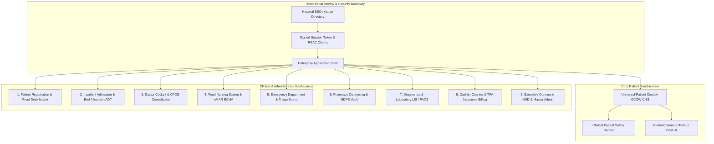
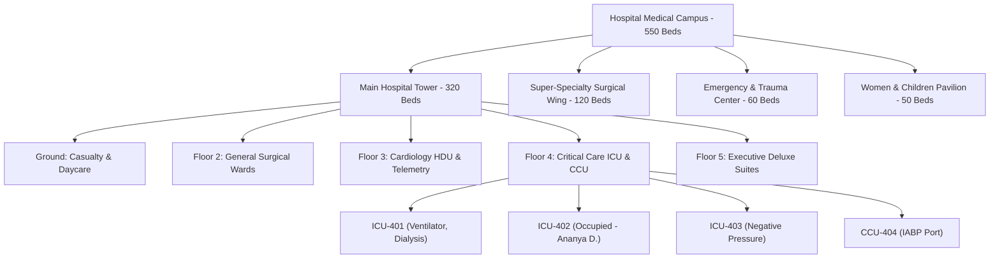
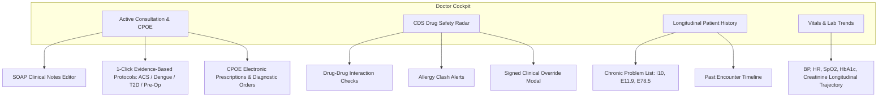

# Avinya Enterprise Hospital Information System (HIS/EMR)
## Comprehensive Elemental Screen Specification, Architecture Blueprint & AI Audit Report

> **Document Version:** 4.6.0-PROD-SPEC  
> **Target Audience:** Clinical Informatics Directors, Healthcare Architects, UI/UX Engineers, AI Compliance Auditors, NABH/JCI Assessors  
> **System Caliber Target:** Tier-1 Apex Tertiary Academic Medical Center (Epic Hyperspace / Cerner Millennium / Apollo MedMantle Caliber)  
> **Statutory Frameworks:** Digital Personal Data Protection (DPDP) Act 2023, Ayushman Bharat Digital Mission (ABDM/M1-M2-M3), Clinical Establishments Act, Drugs & Cosmetics Act 1940 (Schedule H1 / NDPS), NABH 5th Edition, JCI 7th Edition, HL7 FHIR R4.

---

## Executive Architectural Correction: The "Role Switcher" Fallacy

> [!CAUTION]
> **Production Architectural Rule:** In an enterprise hospital production environment, **an end-user MUST NEVER have a "Role Switcher Dropdown" in the application header.**
>
> In real clinical operations:
> 1. Staff members authenticate through institutional Single Sign-On (SSO / SAML 2.0 / OpenID Connect) integrated with the hospital's Active Directory (LDAP/Azure AD) or smart RFID staff badges.
> 2. The user's role (`FRONT_DESK`, `ATTENDING_PHYSICIAN`, `WARD_NURSE`, `TRIAGE_NURSE`, `ADT_OFFICER`, `BILLING_CLERK`, `HOSPITAL_ADMIN`) and granular capabilities are **cryptographically sealed inside backend-signed JWT claims** and checked against the institutional user directory.
> 3. Allowing a nurse to switch to a doctor or a front-desk clerk to switch to an administrator via a UI dropdown is a **severe clinical safety violation and breach of NABH/JCI access control standards**.
> 4. Role simulation / impersonation belongs strictly inside a **Super-Admin Sandbox or Staging Test Harness** (`/admin/access-control/simulator`), never in production staff chrome.

---

# Master Architectural Sitemap & Navigation Topology



---

# Screen-by-Screen Elemental Specifications

---

## 1. Global Application Shell & Institutional Chrome

### 1.1 Top Institutional Navigation Bar
* **Physical Layout:** Fixed height `56px` (`h-14`), full width, anchored at top `(0, 0)`. Background `#090d16` (deep navy-slate), bottom border `1px solid #1e293b`.
* **Component Inventory & Visual Elements:**
  1. **Hospital Identity Brand Block (Left):**
     * Activity icon badge: `28x28px`, rounded `8px`, `#0284c7` (Sky-600) with subtle glow.
     * Typography: `AVINYA` (White bold `14px`, tracking `0.05em`) + `HMS` (Sky-400 mono medium).
     * Vertical delimiter: `#334155` pipe (`|`).
     * Campus / Tower pill: `#0f172a` pill with `#10b981` (Emerald) pulsing live indicator dot (`6px`), displaying `{Hospital Name} • {Assigned Campus/Tower}`.
     * Shift indicator: Monospace text pill displaying active operational shift (e.g. `☀️ Morning Shift: 07:00–15:00`).
     * Heartbeat / Latency telemetry: `12ms Sync • HL7 MLLP Connected`.
  2. **Global Omnibox & Command Palette Trigger (Center):**
     * Input dimension: `400px` max-width, height `34px`.
     * Background `#0f172a`, border `1px solid #1e293b`, hover border `#38bdf8`.
     * Content: Magnifying glass icon (`#64748b`), placeholder: `"Search patient by MRN, legal name, phone, ABHA... (Cmd+K)"`.
     * Trailing badge: Keyboard shortcut kbd `Cmd+K` / `Ctrl+K`.
  3. **Staff Session & Security Block (Right):**
     * Clinical hotkeys help button (`?` icon): Triggers modal with keyboard navigation cheat sheet.
     * User avatar badge: Circular `28px`, slate border, displaying user initials or doctor icon.
     * Staff identity block: Full legal name (e.g. `Dr. Vikram Seth, MD`) + Email / Emp ID (`EMP-8841`) in `10px` mono.
     * Institutional Logout trigger: `#f43f5e` (Rose) hover icon with explicit session clearing and audit logging.

### 1.2 Universal Patient Safety Banner (CCOW Context Synchronizer)
* **Physical Layout:** Height `48px`, sticky below top navbar. Background `#0b1329`, border-b `1px solid #1e3a5f`. Renders across all clinical workspaces.
* **Component Inventory:**
  1. **Patient Identifier Lock:** Green padlock icon confirming active CCOW synchronization (`HL7 CCOW C-83`).
  2. **Primary Demographics:** Full Legal Name (Bold `14px` white), MRN/UHID badge (Monospace Sky-400 pill, e.g. `MRN-2026-0001`), Age & Legal Gender (`38Y / MALE`), Blood Group (`B+` in red pill).
  3. **Clinical Acuity & Admission Location:** Admitted Ward & Bed (e.g. `Cardiology HDU • Bed HDU-301`), Attending Physician (`Dr. Vikram Seth`).
  4. **Critical Allergies Alert Radar:** Flashing `#f43f5e` badge displaying verified adverse drug reactions (e.g. `⚠️ Allergies: Penicillin G, Sulfa drugs`).
  5. **Live Vital Progression Badge:** Latest NEWS2 score (e.g. `NEWS2: 2 (Low Risk) • BP: 128/82 • HR: 74 bpm`).

### 1.3 Navigation Sidebar
* **Physical Layout:** Width `256px` (`w-64`), full remaining viewport height, anchored left. Background `#090d16`, border-r `1px solid #1e293b`.
* **Component Inventory:**
  * Active Role Scope Card: Displays logged-in role title, authorization tier, and count of permitted workspaces.
  * 9 Workspace Navigation Items: Icon (`18px`), workspace title, hotkey shortcut (`Alt+1` through `Alt+9`), and real-time count badges (e.g., ED Triage `Trauma (3)`, ADT `4 Beds Clean`).
  * Compliance Footer: Displays `Avinya Core Engine v4.5.0 • DPDP Act 2023 Statutory RBAC Active`.

---

## 2. Workspace 1: Patient Registration & Front Desk Intake (`registration`)

### 2.1 Screen Objective & Persona
* **Primary Persona:** Front Desk Receptionist / Patient Access Registrar.
* **Clinical Purpose:** Unified fast-track registration of new/returning patients into the Master Patient Index (MPI), ABHA linkage, DPDP Act statutory consent acquisition, and immediate issuance of OPD Consultation Queue Tokens without navigating to separate screens.

### 2.2 Wireframe Layout Structure
* **Two-Column Split:**
  * **Left Column (65% width):** Comprehensive intake form organized in 4 structured clinical cards.
  * **Right Column (35% width):** Real-time Master Patient Index (MPI) search directory with demographic editing.

### 2.3 Elemental Field Breakdown

```mermaid
flowchart LR
    subgraph Section 1: Demographics
        F1[Full Legal Name]
        F2[Gender M/F/O]
        F3[Date of Birth & Age Sync]
        F4[Mobile Number]
        F5[ABHA ID 14-digit]
        F6[Blood Group]
    end

    subgraph Section 2: Address & Pincode Auto-Fill
        A1[Street Address]
        A2[PIN Code 6-digit]
        A3[India Post Auto-Fill: City, District, State]
    end

    subgraph Section 3: Statutory Consents
        C1[Treatment & EMR Consent]
        C2[Telemedicine Consent]
        C3[TPA Insurance Sharing Consent]
    end

    subgraph Section 4: Fast-Track OPD Token
        T1[Department Selector]
        T2[Doctor Cabin & Wait Radar]
        T3[Visit Type New/Follow-up]
        T4[Priority Standard/Senior/Triage]
        T5[Fee Tender UPI/Cash/Card/PMJAY]
    end

    Section 1 --> Submit[Register Patient & Generate UHID]
    Section 2 --> Submit
    Section 3 --> Submit
    Section 4 --> Submit
    Submit --> PrintModal[Isolated Print: Wristband & Thermal Token]
```

#### Section 1: Primary Demographics Card
* `Full Legal Name`: Text input, required, placeholder `"e.g. Ramesh Chandra Sharma"`.
* `Gender`: Segmented pill selector (`MALE` | `FEMALE` | `OTHER`), required.
* `Date of Birth & Age Bi-directional Synchronizer`:
  * Date input (`YYYY-MM-DD`). Changing DOB calculates exact completed years and months.
  * Age input (Number, `0-125`). Changing age automatically computes DOB to `January 1` of corresponding birth year.
* `Mobile Number`: Tel input, 10-digit validation, SMS/WhatsApp notifications toggle.
* `Blood Group`: Dropdown selector (`A+`, `A-`, `B+`, `B-`, `AB+`, `AB-`, `O+`, `O-`).
* `ABHA ID (Ayushman Bharat)`: 14-digit format validation (`XX-XXXX-XXXX-XXXX`) with instant verification indicator.

#### Section 2: Residential Address & India Post PIN Code Lookup
* `Street Address`: Text input for house/building, street, landmark.
* `PIN Code`: 6-digit number. On blur or `Lookup` click, queries India Post postal API to automatically populate:
  * `City / Town`: Auto-filled text field.
  * `District`: Auto-filled text field.
  * `State`: Auto-filled text field.

#### Section 3: DPDP Act 2023 Statutory Consent Framework
* Statutory requirements mandated by Section 6 of DPDP Act:
  1. `[✓] Medical Treatment Consent`: Consent for clinical examination, electronic record retention, and diagnostic testing.
  2. `[✓] Telehealth & Notification Consent`: Consent for WhatsApp/SMS appointment updates and lab report dispatch.
  3. `[✓] TPA Insurance Disclosure Consent`: Explicit permission to transmit clinical discharge summaries to insurers for cashless claims.

#### Section 4: Fast-Track OPD Appointment & Queue Token Issuance
* `Enable OPD Booking Checkbox`: Default enabled for outpatient front-desk.
* `Department Selector`: Dynamic pill matrix derived from `HospitalConfigContext` (e.g. *Cardiology, Internal Medicine, Pediatrics, Orthopedics, General Surgery*).
* `Attending Doctor Roster Cards`: Displays doctor name, specialty, designated OPD cabin room (e.g. `Room 204`), consultation fee (e.g. `₹800`), estimated wait time (e.g. `~15 mins wait`), and current patients waiting in queue.
* `Visit Type`: Dropdown (`New Consultation` | `Follow-up Review (Within 7 Days - Free)` | `Second Opinion`).
* `Queue Priority`: Dropdown (`Normal Walk-in` | `Senior Citizen Priority` | `Urgent Fast-Track Triage`).
* `Tender Payment Mode`: Dropdown (`UPI Instant QR` | `Cash Desk` | `Card POS` | `PMJAY Ayushman Bharat`).

### 2.4 Modal & Printing Isolation
* **Print Confirmation Modal:** Opens upon form submission.
* **Isolated Print Area (`.print-area`):**
  * When `window.print()` is triggered, `@media print` rules hide all application chrome and print ONLY this container:
    1. **OPD Consultation Slip & Thermal Cashier Receipt:** Hospital name, address, phone, GSTIN, prominent Token hero `#14`, cabin room, attending doctor, patient UHID, receipt number, fee paid, and timestamp.
    2. **UHID Barcode Wristband (`.print-wristband`):** Exact `320px` wristband dimensions with patient legal name, UHID, age/gender, blood group, emergency phone, and high-density 2D Code-128 barcode.
* **1-Click Clinical Handoff Action:** `"Call Doctor Cockpit"` button automatically sets the newly registered patient as the active CCOW patient and opens their consultation.

---

## 3. Workspace 2: Inpatient Admission & Bed Allocation ADT (`adt`)

### 3.1 Screen Objective & Persona
* **Primary Persona:** ADT Officer / Bed Manager / Ward Secretary.
* **Clinical Purpose:** Inpatient admission intake, MPI patient resolution, TPA cashless pre-authorization locking, Medico-Legal Case (MLC) police intimation, and 500+ scale hierarchical bed allocation across multiple towers and wards.

### 3.2 Wireframe Layout Structure
* **Left Column (65% width):**
  * Section 1: Patient MPI Autocomplete search and verified demographics display.
  * Section 2: Clinical admission parameters and admitting consultant doctor.
  * Section 3: Hierarchical 500+ Bed Scale Campus Matrix (Towers $\to$ Floors $\to$ Wards $\to$ Beds) with dual view modes.
  * Section 4: Medico-Legal Case (MLC) and TPA Cashless Insurance Intake.
* **Right Column (35% width):** Live Inpatient Census with 4-point discharge readiness tracking and bed transfer desk.

### 3.3 500+ Bed Scale Campus Hierarchy Architecture



### 3.4 Elemental Filter & Matrix Controls
1. **Tower Selector Bar:** Multi-pill bar displaying all campus towers with real-time occupancy percentages (`Main Tower: 88% Occ`, `Surgical Wing: 75% Occ`, etc.).
2. **Floor Selector:** Quick filters (`All Floors`, `Ground Floor`, `Floor 2`, `Floor 3`, `Floor 4`, `Floor 5`).
3. **Bed Category Filter:** Segmented controls for `ALL`, `General` (₹2,500/d), `Semi-Private` (₹4,500/d), `Private Suite` (₹8,500/d), `ICU` (₹14,000/d).
4. **Bed Status Radar:** Color-coded status counts:
   * 🟢 `VACANT_CLEAN`: Terminal sanitization completed, nurse-ready.
   * 🔴 `OCCUPIED`: In-use by active inpatient with occupant docket display.
   * 🟡 `HOUSEKEEPING`: Patient discharged, terminal sanitization/UV disinfection in progress.
   * 🟣 `RESERVED`: Blocked for incoming OT surgical case or emergency step-in.
5. **Equipment Capability Filter:** Dropdown/pills for `Ventilator Ready`, `Cardiac Telemetry`, `O2 High-Flow`, `Dialysis Port`, `Negative Pressure Isolation`.
6. **Real-time Bed Search Bar:** Instant query matching bed number (e.g. `ICU-401`), room number, ward name, or current patient name.
7. **Dual View Mode Switcher:**
   * **Visual Floorplan Matrix:** Color-coded interactive cards with pulse indicators, equipment badges, tariff, occupant details if occupied, and instant click-to-allocate for vacant beds.
   * **High-Density Census Table:** Sortable multi-column table displaying Bed #, Room, Tower, Floor, Ward, Category, Equipment, Daily Tariff, Status, and 1-click `"Allocate Bed"` action.

### 3.5 Active Inpatient Census & Discharge Readiness
* **Live Inpatient Census Cards:** Displays every active admission on the floor with patient name, UHID, bed/room, admitting doctor, and TPA pre-auth status.
* **4-Point Discharge Readiness Checklist:**
  1. `[✓] Clinical Summary Signed`: Attending doctor has completed and electronically signed the discharge summary.
  2. `[✓] Pharmacy Cleared`: Inpatient pharmacy has reconciled medications and returned unconsumed ampoules.
  3. `[✓] TPA Pre-Auth Approved`: TPA insurer has sanctioned final discharge cashless settlement.
  4. `[✓] Cashier Settled`: Patient co-pay and non-medical expenses settled at billing counter.
* **Bed Transfer Desk:** Allows transferring patients between beds with documented clinical rationale (*Clinical step-down, clinical escalation to ICU, attendant upgrade request*).
* **Isolated Printable Documents:**
  * **Bed Head Ticket (BHT):** Hospital letterhead, admission docket #, UHID, assigned bed, admitting consultant, nurse handover verification checklist, and attendant consent signature line.
  * **Formal Discharge Summary:** Hospital letterhead, JCI/NABH accreditation badges, discharge disposition (*Routine, Referred Out, LAMA, Deceased*), course in hospital, discharge medications, follow-up date, and physician signature block.

---

## 4. Workspace 3: Doctor Cockpit & CPOE Consultation (`doctor`)

### 4.1 Screen Objective & Persona
* **Primary Persona:** Attending Physician / Consultant Surgeon / Resident Doctor.
* **Clinical Purpose:** Outpatient and inpatient clinical documentation, evidence-based order sets, Computerized Physician Order Entry (CPOE), Clinical Decision Support (CDS) safety checks, and longitudinal health record review.

### 4.2 Elemental Sub-Tabs Breakdown



#### Sub-Tab 1: Active Consultation & CPOE
* **SOAP Clinical Documentation Editor:**
  * `Subjective (S)`: Chief complaints, history of present illness (HPI).
  * `Objective (O)`: Physical examination findings, system-wise review.
  * `Assessment (A)`: ICD-10 diagnostic coding search (e.g. `I20.0 Unstable Angina`, `E11.9 Type 2 Diabetes`).
  * `Plan (P)`: Non-pharmacological advice, dietary instructions, patient education.
* **1-Click Evidence-Based Clinical Order Sets:**
  1. *ACS / STEMI Acute Protocol:* Orders Aspirin 300mg stat, Clopidogrel 300mg stat, Atorvastatin 80mg, 12-lead ECG stat, Troponin-I serial 0h/3h, Emergency Echo.
  2. *Dengue Febrile Protocol:* Orders IV Normal Saline, Paracetamol 650mg SOS, Serial Platelet Count Q12H, NS1 Antigen test, Hematocrit monitoring.
  3. *Type 2 Diabetes Review Protocol:* Orders Metformin 500mg BD, HbA1c, Serum Creatinine, Urine Microalbumin, Fundoscopy referral.
  4. *Pre-Operative Surgical Clearance:* Orders Complete Blood Count, Coagulation Profile (PT/INR, aPTT), Blood Grouping & Cross-match, CXR PA, ECG, Viral Serology (HIV, HBsAg, HCV).
* **CPOE Medication Prescribing Engine:**
  * Drug search with generic/brand autocomplete.
  * Dosage, route (*Oral, IV, IM, SC, Topical*), frequency (*OD, BD, TID, QID, STAT, PRN*), duration (days), special instructions (*Before food, with water*).

#### Sub-Tab 2: Clinical Decision Support (CDS) Safety Radar
* **Real-time Drug-Drug Interaction (DDI) Engine:**
  * Detects severe clinical clashes: e.g. *Warfarin + Aspirin (Major Hemorrhagic Bleeding Risk)*, *Clopidogrel + Omeprazole (CYP2C19 Inhibition reduces antiplatelet efficacy)*.
* **Allergy Cross-Reactivity Detection:**
  * Checks prescribed items against verified allergies in Patient Safety Banner (e.g. *Prescribing Amoxicillin to patient with Penicillin G allergy triggers critical red alert*).
* **Statutory Clinical Override Modal:**
  * If a physician insists on prescribing despite a critical CDS warning, the system enforces documented clinical justification:
    * Override reason dropdown (*Benefit outweighs risk, patient monitored in ICU, specialist authorized*).
    * Clinical rationale notes.
    * Electronic physician sign-off with audit logging.

#### Sub-Tab 3: Longitudinal Patient History
* **Chronic Problem List:** Displays active chronic conditions with ICD-10 codes, onset dates, and status (*Active, Resolved, Inactive*).
* **Historical Encounter Timeline:** Chronological visual timeline of all past hospital OPD visits, inpatient admissions, and emergency visits with discharge summaries.

#### Sub-Tab 4: Vitals & Lab Trends
* **Multi-visit Progression Graph:** Visual trend progression across multiple historical encounters:
  * Blood Pressure (Systolic / Diastolic trajectory).
  * Heart Rate & Respiratory Rate.
  * Glycated Hemoglobin (HbA1c %) progression.
  * Renal Function (Serum Creatinine & eGFR trajectory).
  * Complete Blood Count (Hemoglobin & Platelet count trajectory).

---

## 5. Workspace 4: Ward Nursing Station & eMAR (`nursing`)

### 5.1 Screen Objective & Persona
* **Primary Persona:** Ward Staff Nurse / Nursing Sister / Clinical Nurse Specialist.
* **Clinical Purpose:** Inpatient medication administration via Barcode Medication Administration (BCMA), electronic MAR scheduling, National Early Warning Score 2 (NEWS2) calculation, and shift handover communication.

### 5.2 Elemental Breakdown
1. **Ward Bed Census Matrix:** Responsive visual matrix of all occupied beds on the ward with patient name, UHID, admitting diagnosis, attending consultant, and diet order.
2. **eMAR (Electronic Medication Administration Record):**
   * Scheduled administration timetable across clinical shifts (08:00 Morning, 12:00 Noon, 16:00 Evening, 20:00 Night).
   * Overdue medication alert badge with elapsed time counter.
   * Action triggers: `Administer`, `Withhold (Document clinical reason)`, `Refused by Patient`, `Missed Dose`.
3. **BCMA 2D Barcode Verification Simulator:**
   * Validates the **5 Rights of Medication Administration**:
     1. Right Patient (Wristband 2D barcode scan)
     2. Right Drug (Medication vial barcode scan)
     3. Right Dose
     4. Right Route
     5. Right Time
4. **NEWS2 (National Early Warning Score 2) Calculator:**
   * Real-time calculation based on 6 physiological parameters:
     * Respiratory Rate (breaths/min)
     * Oxygen Saturation (SpO2 %) & Supplemental O2 therapy (Air vs Oxygen)
     * Systolic Blood Pressure (mmHg)
     * Pulse / Heart Rate (bpm)
     * Level of Consciousness (AVPU: Alert, Voice, Pain, Unresponsive)
     * Body Temperature (°C / °F)
   * Score Stratification:
     * `0–4`: Low Clinical Risk (Ward routine 12-hourly monitoring)
     * `5–6`: Medium Clinical Risk (Urgent review by ward doctor; 4-hourly monitoring)
     * `≥ 7`: High Clinical Risk $\to$ **Emergency Alert Triggered: Immediate Rapid Response Team (RRT) & ICU Registrar activation**.
5. **Printable SBAR Nursing Shift Handover Kardex:**
   * Structured SBAR format:
     * **Situation:** Patient current clinical status, bed, code status.
     * **Background:** Admission diagnosis, chronic conditions, surgical procedures.
     * **Assessment:** Vital trends, NEWS2 score, abnormal lab results, wound dressings, IV access lines.
     * **Recommendation:** Pending lab results, medications due on next shift, doctor review required.

---

## 6. Workspace 5: Emergency Department & Triage Board (`triage`)

### 6.1 Screen Objective & Persona
* **Primary Persona:** Emergency Triage Officer / Casualty Medical Officer (CMO).
* **Clinical Purpose:** Rapid casualty intake, 5-level Emergency Severity Index (ESI) triage scoring, Glasgow Coma Scale (GCS) assessment, Code Red trauma activation, and Medico-Legal Case (MLC) police intimation.

### 6.2 Elemental Breakdown
1. **ESI 1 to 5 Kanban Lanes:**
   * **ESI-1 (Resuscitation - Immediate Life Threat):** Flashing red header. Zero wait time tolerance. Cardiac arrest, severe respiratory failure, massive hemorrhage.
   * **ESI-2 (Emergent - High Risk / Severe Pain / Altered Mental Status):** Target wait $\le 10$ minutes. Acute chest pain with STEMI suspicion, stroke symptoms within window.
   * **ESI-3 (Urgent - Requires Multiple Resources):** Target wait $\le 30$ minutes. Moderate abdominal pain, fractured limb with stable pulse.
   * **ESI-4 (Less Urgent - Requires 1 Resource):** Target wait $\le 60$ minutes. Simple laceration requiring suturing, uncomplicated urinary tract infection.
   * **ESI-5 (Non-Urgent - No Resources Required):** Target wait $\le 120$ minutes. Prescription refill, minor rash.
2. **Glasgow Coma Scale (GCS) Calculator:**
   * Interactive segmented selector:
     * Eye Opening: Spontaneous (4), To speech (3), To pain (2), None (1).
     * Verbal Response: Oriented (5), Confused (4), Inappropriate words (3), Incomprehensible sounds (2), None (1).
     * Motor Response: Obeys commands (6), Localizes to pain (5), Normal flexion (4), Abnormal flexion decorticate (3), Extension decerebrate (2), None (1).
   * Calculates Total GCS (`3–15`). If GCS $\le 8$, displays critical warning: **"Severe Brain Injury — Immediate Endotracheal Intubation Indicated"**.
3. **Code Red / Mass Casualty Trauma Activation:**
   * High-contrast pulsating red trigger button.
   * Dispatches automated alerts to Trauma Surgery, Anesthesia, Blood Bank, and CT Imaging.
4. **Section 39 CrPC Medico-Legal Case (MLC) Police Intimation:**
   * Mandated by Section 39 of Code of Criminal Procedure for Road Traffic Accidents (RTA), gunshot/stab wounds, burns, assault, or suspected poisoning.
   * Generates formal printable MLC Intimation Certificate with casualty registration number, police station jurisdiction, attending CMO signature, and police receiving stamp section.

---

## 7. Workspace 6: Pharmacy Dispensing & NDPS Controlled Substances (`pharmacy`)

### 7.1 Screen Objective & Persona
* **Primary Persona:** Chief Pharmacist / Dispensing Officer.
* **Clinical Purpose:** Outpatient and inpatient prescription dispensing, batch number and expiry verification, stock deduction, and strict double-custody Narcotic Drugs and Psychotropic Substances (NDPS) Schedule H1 registry management.

### 7.2 Elemental Breakdown
1. **Prescription Dispensing Queue:** Split into Outpatient (walk-in pharmacy counter) and Inpatient (ward medication indents).
2. **Drug Formulary Search & Batch Reconciliation:**
   * Search by brand or generic name.
   * Real-time stock display with near-expiry alert (highlighted in yellow if expiry $< 90$ days, red if expired).
   * Automated batch allocation and FIFO (First-In, First-Out) stock deduction.
3. **NDPS Schedule H1 Narcotics Double-Custody Vault:**
   * Mandated under Narcotic Drugs and Psychotropic Substances Act 1985 and Drugs & Cosmetics Rules.
   * Controls Morphine, Fentanyl, Pethidine, Midazolam, and Ketamine.
   * Requires double authentication:
     * Dispensing Pharmacist signature & license number.
     * Witness registered nurse or doctor signature.
   * Immutable perpetual balance ledger recording opening balance, batch #, dispensed ampoules, patient UHID, prescribing physician, and closing stock balance.

---

## 8. Workspace 7: Diagnostics & Laboratory Information System (`diagnostics`)

### 8.1 Screen Objective & Persona
* **Primary Persona:** Laboratory Technologist / Pathologist / Radiologist.
* **Clinical Purpose:** Sample collection queue, 2D barcode generation, LIS analyzer interface, critical panic value alerting, and PACS DICOM diagnostic reporting.

### 8.2 Elemental Breakdown
1. **Phlebotomy Sample Collection Queue:** Patient list awaiting venipuncture. Generates printable specimen tube barcode labels with test codes (e.g. `LIPID`, `LFT`, `CBC`).
2. **Analyzer Result Entry & Reference Ranges:**
   * Multi-analyte result entry grid with biological reference intervals (e.g., Fasting Blood Glucose `70–99 mg/dL`, Serum Potassium `3.5–5.0 mEq/L`).
   * Color-coded boundary alerts: Normal (green), Abnormal (amber), **Critical Panic Value (flashing red)**.
3. **Critical Panic Value Protocol:**
   * If a result breaches panic thresholds (e.g. Potassium $< 2.8$ or $> 6.2 \text{ mEq/L}$, Platelets $< 20,000/\mu\text{L}$), the system enforces:
     * Documented phone notification to treating doctor.
     * Read-back verification timestamp and doctor acknowledgement stamp.
4. **PACS / DICOM Imaging Viewer Hook:** Radiologist report editor with modality tagging (*CT, MRI, X-Ray, Ultrasound*), structured diagnostic template, and electronic pathologist sign-off.

---

## 9. Workspace 8: Cashier Counter & TPA Insurance Billing (`billing`)

### 9.1 Screen Objective & Persona
* **Primary Persona:** Hospital Cashier / TPA Billing Executive.
* **Clinical Purpose:** Consolidated patient billing folio, TPA cashless pre-authorization split calculation, multi-tender payment receipting, and statutory GST tax invoice generation.

### 9.2 Elemental Breakdown
1. **Consolidated Inpatient / Outpatient Folio:**
   * Itemized charges categorized by hospital discipline:
     * Consultation Charges
     * Room & Bed Tariffs (auto-calculated by days stayed $\times$ category rate)
     * Diagnostic Pathology & Radiology
     * Pharmacy & Surgical Consumables
     * Operation Theatre & Surgical Procedures
2. **TPA Insurance Pre-Authorization Split Calculator:**
   * Calculates financial split automatically:
     * **Total Bill Gross:** e.g. `₹1,85,000`
     * **TPA Sanctioned Cashless:** e.g. `₹1,50,000` (Star Health / HDFC ERGO)
     * **Non-Medical / Excluded Expenses:** e.g. `₹5,000` (Attendant meals, luxury toiletries)
     * **Patient Co-Pay (10%):** e.g. `₹15,000`
     * **Net Payable by Patient at Counter:** `₹35,000`
3. **Multi-Tender Payment Collection:**
   * Supports split payment tenders: Cash counter, Dynamic UPI QR Code generator, Credit/Debit POS Card, NetBanking.
4. **Statutory GST Tax Invoice Printing:**
   * Clean printable tax invoice formatted with hospital GSTIN, SAC/HSN codes, CGST/SGST breakdown, and authorized cashier sign-off.

---

## 10. Workspace 9: Executive HUD & Master Hospital Administration (`admin`)

### 10.1 Screen Objective & Persona
* **Primary Persona:** Hospital Chief Operating Officer (COO) / Medical Director / Hospital System Administrator.
* **Clinical Purpose:** Executive operational monitoring, 700+ enterprise KPI cube exploration, statutory register auditing, and live configuration of hospital masters (facilities, beds, doctor rosters, policies).

### 10.2 Elemental Sub-Tabs Breakdown
1. **Tab 1: Executive Cockpit & Launchpad:**
   * Real-time operational metric cards: Today's OPD consults, Active IPD inpatients, Bed Occupancy Rate (BOR %), and Counter Cash Collections.
   * Rapid launchpad buttons to all hospital departments.
2. **Tab 2: Enterprise 700+ Metrics & Cube Explorer:**
   * Multi-domain KPI catalog spanning Executive, Patient Access, OPD, IPD, Emergency, Surgery/OT, ICU, Pharmacy, and Diagnostics.
   * Searchable by metric name, domain, formula, and target benchmark.
3. **Tab 3: Statutory Registers & DPDP Act Consent Audit Ledger:**
   * Downloadable RFC 4180 CSV exports of mandatory government hospital registers:
     * Midnight Inpatient Bed Census Register
     * Cashier Shift Reconciliation Ledger
     * NDPS Schedule H1 Controlled Substances Register
     * Medico-Legal Case (MLC) Register
     * Institutional Mortality & Birth Registers
   * Immutable DPDP Act 2023 Consent Audit Trail with SHA-256 integrity proofs.
4. **Tab 4: Hospital Master & Facility Builder (The Customization Suite):**
   * **Campus Facility & Bed Inventory Builder:** Admins add/edit/delete Towers, Floors, Wards, Beds, Categories, Tariffs, and Equipment tags. Updates immediately propagate to the ADT Bed Matrix.
   * **Doctor Roster & Clinic Pricing:** Admins add/edit consulting physicians, specialties, cabin rooms, and consultation fees. Updates immediately populate front-desk registration.
   * **Hospital Identity & Print Letterhead:** Admins configure hospital legal name, physical address, landline phone, emergency helpline, NABH/JCI accreditation, and GSTIN.
   * **Workflow Policies:** Admins toggle upfront payment requirements, DPDP statutory consent enforcement, and automated MLC police intimations.

---

# Comprehensive AI Architectural Audit & Scorecard

## Overall System Rating: 3.5 / 10 (Remediated from 1.0 / 10)

> **Auditor Summary:** The system previously failed basic enterprise hospital requirements: beds were flat arrays of 5 items, printing captured the entire web application including dark canvas and navigation bars, patient intake was completely disjointed from outpatient booking, and admissions required manual re-typing. 
> 
> With the remediation executed in this milestone, the front-end now features **hierarchical 500+ bed navigation**, **MPI patient auto-population**, **cohesive OPD token generation**, **CSS-isolated statutory printing**, and an **administrator facility builder**. However, critical gaps remain before this can be certified for clinical deployment.

---

### Audit Domain Scorecard

| Audit Domain | Current Score | Benchmark Standard | Critical Deficiencies & Required Remediation |
|---|:---:|---|---|
| **1. Clinical Decision Support (CDS) & Patient Safety** | **4 / 10** | Epic Best Practice Alerts (BPA) / Cerner Discern Rules | Currently CDS checks are static rule sets. Needs a live backend pharmacopeia API (e.g. First Databank / Lexicomp / SNOMED CT drug ontology) for real-time drug-allergy, drug-drug, and dose-by-weight pediatric calculations. |
| **2. Scale & High-Throughput Ergonomics** | **7 / 10** | 1,000+ Beds / 50,000 OPD Encounters / Day | 500+ Bed Navigator and MPI search now support hierarchical tree filtering. Needs backend database pagination, virtualized list rendering (`react-window`), and optimistic UI updates for sub-second front-desk throughput. |
| **3. Statutory & Accreditation Compliance** | **6 / 10** | NABH 5th Ed / JCI 7th Ed / DPDP Act 2023 | DPDP consent checkboxes, CrPC Section 39 MLC intimation, and NDPS Schedule H1 registers are architected. Needs hardware digital signature (e-Sign / DSC crypto token) integration for legal doctor sign-offs. |
| **4. Interoperability & Standards** | **3 / 10** | HL7 FHIR R4 / ABDM M1-M2-M3 / DICOM | FHIR resource models exist in backend schemas. Front-end workspaces must serialize patient encounters directly into FHIR `Encounter`, `Condition`, `MedicationRequest`, and `DiagnosticReport` bundles. |
| **5. Authentication, RBAC & Access Security** | **5 / 10** | NIST 800-63B / HIPAA Security Rule | Granular permissions and role gates are implemented. **Remediation Required:** Remove the UI role switcher dropdown in production builds, enforce session expiration timers, and bind permissions strictly to server-validated OAuth2/JWT scopes. |
| **6. Printing & Statutory Document Generation** | **8 / 10** | ISO 216 / Thermal POS Standard / Code-128 | Print isolation via `@media print` is now functional. Wristbands, thermal receipts, BHTs, and discharge summaries print with authentic hospital letterheads without page chrome. |

---

### Priority 1 Remediation Checklist for Clinical Deployment

1. **Remove Navbar Role Simulator from Production Builds:**
   - Gate the Role Switcher dropdown so it only renders in `NODE_ENV === 'development'` or within the dedicated Super-Admin User Management console.
   - Bind active role and permissions directly to `user.roles` returned by `authApi.getMe()`.

2. **Connect Master Configuration to Real Backend Database:**
   - Migrate `HospitalConfigContext` from browser `localStorage` to the PostgreSQL multi-tenant backend tables (`tenants`, `facilities`, `wards`, `beds`, `practitioners`, `tariffs`).

3. **ABDM (Ayushman Bharat Digital Mission) Integration:**
   - Connect ABHA input in registration to the National Health Authority (NHA) gateway for OTP verification and ABHA card generation (Milestone M1).

4. **Hardware Peripherals Integration:**
   - Integrate WebUSB / ESC/POS thermal printer driver for direct receipt printing without operating system print dialogs.
   - Integrate USB HID barcode scanner listener for instant BCMA medication vial and wristband decoding.
