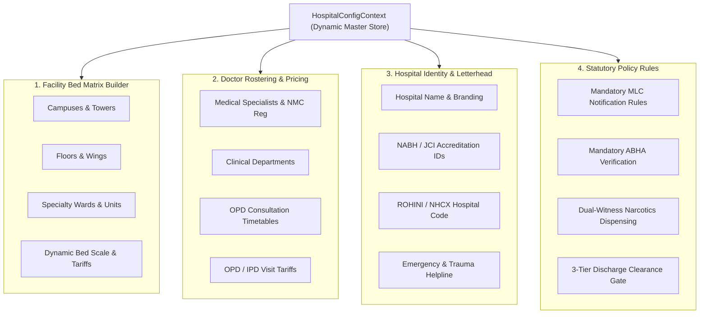

# Chapter 12: Enterprise Hospital UI, Workspaces & Dynamic Customization

**Document Version:** `2.1.0-ENTERPRISE`  
**Application Tier:** Client Single Page Application (`hospital-ui/`)  
**Core Stack:** React 18, TypeScript 5, Vite 6, Tailwind CSS 3, Lucide React  
**Reference Specification:** [`docs/ENTERPRISE_HOSPITAL_UI_SPECIFICATION_AND_AUDIT.md`](../ENTERPRISE_HOSPITAL_UI_SPECIFICATION_AND_AUDIT.md)  
**Metrics & KPI Inventory:** [`docs/ENTERPRISE_METRICS_AND_KPI_INVENTORY.md`](../ENTERPRISE_METRICS_AND_KPI_INVENTORY.md)  

---

## 1. Executive Overview & UI Architectural Principles

The Avinya HMS Client UI (`hospital-ui`) is an industrial-strength, responsive clinical workstation designed for multi-tier healthcare facilities ranging from 50-bed community clinics to 1,500+ bed tertiary medical colleges and healthcare conglomerate networks.

Unlike traditional static web forms that create cognitive overload, navigation fragmentation, and medical error risks, the UI operates on five uncompromising enterprise tenets:

1. **Persistent Patient Safety Context (CCOW Pattern):** A persistent Global Patient Banner anchors the active patient context across all clinical screens, displaying critical safety indicators (Allergies, Blood Group, Active Admission, Fall Risk, Resuscitation Status) to prevent wrong-patient order entry errors.
2. **Unified High-Velocity Intake:** Eradicates disconnected registration flows. When an outpatient enters the hospital, front-desk staff can register demographics, generate a unique Master Patient Index (MPI) UHID, assign an attending doctor, book an appointment, and print a thermal barcode queue token in a single streamlined screen.
3. **Multi-Scale Bed Matrix (500+ Bed Scale):** Inpatient ADT and Nursing workspaces utilize a 4-tier structural hierarchy (`Campus/Tower -> Floor -> Ward/Unit -> Bed`) with real-time operational status filters (Occupied, Available, Cleaning, Maintenance, Reserved, Isolation) capable of managing massive bed counts without infinite-scrolling or UI freezing.
4. **Hardware-Isolated Thermal Printing:** Standard browser `window.print()` cascades dark backgrounds, sidebars, and navbars. Avinya HMS enforces an isolated `@media print` style engine that strips all application chrome, rendering only the `.print-area` or `.print-wristband` formatted precisely for 2-inch thermal wristband printers or standard A4/A5 letterhead printers.
5. **Cryptographic RBAC & Session Binding:** Operational capabilities are cryptographically bound to authenticated JWT identity claims (`user.roles` and `is_superuser`). The UI enforces strict role-gating via `<PermissionGate>`. Arbitrary role switching is completely locked out in production builds and demoted to a clearly marked, isolated simulator active only in local development (`import.meta.env.DEV`).

---

## 2. Global Shell & Navigation Topology

The UI shell consists of four synchronized architectural components:

```
+---------------------------------------------------------------------------------------------------+
|  [AVINYA HMS] | Apollo Main Tower | Morning Shift | 12ms Sync    [Cmd+K Search...]    [VERIFIED: DOCTOR] [?] [Staff Profile] [Logout] |
+---------------------------------------------------------------------------------------------------+
| PATIENT SAFETY BANNER: Doe, John (42M) | MRN: AV-2026-00412 | O+ | ALLERGIES: PENICILLIN (ANAPHYLAXIS) | CODE STATUS: FULL CODE    |
+-------------------+-------------------------------------------------------------------------------+
| [REGISTRATION]    |                                                                               |
| [INPATIENT ADT]   |                                                                               |
| [DOCTOR COCKPIT]  |                                                                               |
| [WARD NURSING]    |                                                                               |
| [EMERGENCY ED]    |                       ACTIVE CLINICAL / OPERATIONAL WORKSPACE                 |
| [PHARMACY]        |                                                                               |
| [DIAGNOSTICS]     |                                                                               |
| [BILLING COUNTER] |                                                                               |
| [ADMIN CONSOLE]   |                                                                               |
+-------------------+-------------------------------------------------------------------------------+
| FOOTER: Avinya Clinical Node v2.1.0-ENTERPRISE | ISO 27001 / DPDP Act 2023 Compliant | Real-Time Sync Active (12ms) |
+---------------------------------------------------------------------------------------------------+
```

### High-Speed Hotkey Navigation Matrix
Hospital workstations demand rapid keyboard-first throughput. Avinya HMS implements zero-mouse hotkeys:

| Key Binding | Target Clinical Destination | Primary Operational Workflow |
|---|---|---|
| **Cmd+K / Ctrl+K** | Universal Command Palette | Global MPI Patient Search & Fast Workspace Navigation |
| **Alt + 1** | Patient Intake & Front Desk | Demographic intake, ABHA lookup, Fast-Track OPD Token |
| **Alt + 2** | Inpatient ADT & Bed Matrices | Bed allocation, transfer, MLC Section 39 CrPC intimation |
| **Alt + 3** | Doctor Clinical Cockpit | Longitudinal EMR, SOAP notes, CPOE e-Prescription |
| **Alt + 4** | Ward Nursing Station | eMAR bedside administration, NEWS2 deterioration scoring |
| **Alt + 5** | Emergency Triage Board | ESI 1–5 triage Kanban, Glasgow Coma Scale, Code Red |
| **Alt + 6** | Cashier Counter & Finance | Categorized folio charges, TPA insurance split, GST billing |
| **Alt + 7** | Central Pharmacy & Vault | Formulary dispensing, NDPS Schedule H1 double-witness vault |
| **Alt + 8** | Diagnostic Laboratory (LIS) | Specimen accessioning, Panic Delta read-back protocol |
| **Alt + 9** | Executive Command HUD | 700+ Metric cube explorer, Facility Builder & Roster Master |
| **Esc** | Universal Modal Escape | Closes any active modal or drawer without committing changes |

---

## 3. The Nine Dedicated Clinical & Operational Workspaces

### Workspace 1: Patient Registration & Front-Desk Intake
- **Master Patient Index (MPI):** Instant deduplication across National ID, ABHA number, phone number, and demographic fuzzy matching.
- **Unified Fast-Track Consultation Token:** Single-screen transition from demographic entry to selecting attending physician, appointment slot, collecting initial registration fees, and issuing an OPD queue token.
- **DPDP Act 2023 Consent Collection:** Mandatory digital consent recording under Section 6 of India's DPDP Act with explicit consent purpose tracking and data principal rights notifications.
- **Isolated Wristband Printing:** Immediate generation of waterproof 2D Datamatrix patient wristbands displaying MRN, Patient Name, Age, Gender, and Blood Group without printing web chrome.

### Workspace 2: Inpatient Admission & Bed Allocation (ADT)
- **MPI Autocomplete Search:** Front-desk and admission officers enter patient MRN or name to instantly hydrate demographic history, active admissions, and insurance profiles.
- **500+ Bed Scale Hierarchy:** Multi-tier filtering across Campuses, Towers, Floors, and Specialty Wards (ICU, CCU, NICU, General Male/Female, Private Deluxe, Isolation).
- **Medico-Legal Case (MLC) Protocol:** Automated police intimation generation under Section 39 CrPC for road traffic accidents (RTA), gunshot/assault injuries, burns, and poisoning cases.
- **TPA Pre-Authorization Tracker:** Tracks insurer approval limits, cashless eligibility, deductible limits, and co-pay percentages prior to room allocation.

### Workspace 3: Doctor Clinical Cockpit & CPOE Consultation
- **Subjective / Objective / Assessment / Plan (SOAP):** Structured clinical note editor with rich templates, ICD-10 diagnosis search, and longitudinal EMR timeline.
- **Clinical Decision Support (CDS) Radar:** Real-time drug-drug interaction (DDI) and drug-allergy conflict detection with severity classification (Severe/Contraindicated vs. Moderate) and mandatory clinical override reason logging.
- **CPOE 1-Click Order Sets:** Pre-configured clinical order bundles (e.g. Acute Coronary Syndrome Bundle, Sepsis Resuscitation Set, Diabetic Ketoacidosis Protocol) allowing comprehensive lab, imaging, and medication ordering in under 5 seconds.

### Workspace 4: Ward Nursing Station, eMAR & Bedside Safety
- **Electronic Medication Administration Record (eMAR):** Time-slotted visual administration grid (08:00, 12:00, 16:00, 20:00) with color-coded drug schedules (Given, Due, Overdue, Held, Refused).
- **BCMA 2D Barcode Verification:** Enforces the Joint Commission / NABH **"5 Rights of Medication Administration"** (Right Patient, Right Drug, Right Dose, Right Route, Right Time) via bedside optical scanner before syringe or infusion delivery.
- **NEWS2 Deterioration Escalation:** Automated National Early Warning Score 2 computation based on Respiratory Rate, SpO2, Systolic BP, Pulse, Consciousness (AVPU), and Temperature. High scores ($\ge 7$) trigger immediate audio-visual Code Blue / Rapid Response Team (RRT) alert modals.
- **SBAR Shift Handover Kardex:** Structured Situation, Background, Assessment, Recommendation Kardex for seamless inter-shift nursing handoffs.

### Workspace 5: Emergency Department Triage Board
- **Emergency Severity Index (ESI 1–5) Kanban:** Visual drag-and-drop or algorithmic triage categorization:
  - *ESI 1 (Resuscitation / Immediate)* - Unresponsive, cardiac arrest, severe respiratory failure.
  - *ESI 2 (Emergent / <15 mins)* - High risk, acute chest pain, altered mental status.
  - *ESI 3 (Urgent / 2+ resources)* - Moderate abdominal pain, stable fractures.
  - *ESI 4 (Less Urgent / 1 resource)* - Simple lacerations, sore throat.
  - *ESI 5 (Non-Urgent / 0 resources)* - Medication refill, minor rash.
- **Glasgow Coma Scale (GCS) Calculator:** Objective 3-part neurological assessment (Eye Opening 1-4, Verbal Response 1-5, Motor Response 1-6).
- **Code Red Mass Casualty Protocol:** Single-button activation that unlocks rapid anonymous disaster triage tags (`DISASTER-TRIAGE-001` through `999`), overrides bed reservations, and broadcasts hospital-wide mass casualty alerts.

### Workspace 6: Pharmacy Dispensing & Controlled Substances Vault
- **Formulary Order Processing:** Real-time synchronization with doctor CPOE orders with stock availability indicators and generic substitute recommendations.
- **NDPS Schedule H1 & X Narcotics Vault:** Perpetual double-custody digital register for controlled substances (Morphine, Fentanyl, Ketamine, Pethidine). Dispensing requires dual-witness authentication (two licensed staff signatures) and automatic balance reconciliation.
- **Batch Expiry & Temperature Surveillance:** Visual cold-chain tracking ($2^\circ\text{C} - 8^\circ\text{C}$ alerts) and FEFO (First-Expired, First-Out) dispensing rules.

### Workspace 7: Diagnostic Laboratory Information System (LIS)
- **Phlebotomy & Specimen Accessioning:** Generates Code-128 barcode specimen labels for serum, EDTA, and fluoride tubes. Tracks specimen draw time, accessioning, centrifugation, and instrument loading.
- **Panic Critical Value Protocol:** Automated detection of panic delta thresholds (e.g., Potassium $<2.5$ or $>6.2\,\text{mEq/L}$, Troponin-I $>0.04\,\text{ng/mL}$, Platelets $<20,000/\mu\text{L}$). Enforces mandatory documented telephone read-back with attending clinician within 15 minutes.
- **Integrated DICOM PACS Viewer:** Zero-footprint web viewer with window-leveling, pan, zoom, Cobb angle measurement, and radiologist report transcription.

### Workspace 8: Cashier Counter & TPA Insurance Billing
- **Categorized Inpatient Folio:** Real-time aggregation of Bed Rent, Nursing Charges, Doctor Consultation Fees, OT Surgeries, Pharmacy Dispensing, and Diagnostic Investigations.
- **TPA / Cashless Split Allocator:** Seamless separation between Insurance Approved Amount, Statutory Non-Payable Items (gloves, sanitizers, administrative fees), Co-pay/Deductibles, and Patient Payable Balances.
- **Multi-Tender Receipting & GST Tax Invoicing:** Supports Split Payments (Cash + UPI + Credit Card + NEFT) with automated GST calculation (CGST + SGST or IGST) and instantaneous thermal receipt generation.

### Workspace 9: Executive Command HUD & Master Administration
- **Executive Operational Metrics:** Real-time display of Hospital Occupancy Rate, Average Length of Stay (ALOS), Bed Turnover Interval, Revenue Per Occupied Bed (RevPOB), Unbilled Folio WIP, and ED Left Without Being Seen (LWBS) rate.
- **700+ Metric Enterprise Cube Explorer:** Interactive multidimensional KPI navigator across 8 functional hospital cubes (Clinical Quality, ADT Utilization, Financial Revenue Cycle, Pharmacy Inventory, Laboratory Telemetry, Workforce, Patient Safety, Statutory Compliance).
- **Hospital Master & Facility Builder:** Live dynamic administrative configuration console enabling hospital leadership to customize facility structures, doctor rosters, tariffs, and hospital policies on the fly without engineering code changes.

---

## 4. Dynamic Hospital Customization Console

Hospital operations vary drastically across institutions. Avinya HMS provides a complete live configuration subsystem backed by [`HospitalConfigContext.tsx`](file:///v:/avinya_hms/hospital-ui/src/core/context/HospitalConfigContext.tsx):



Changes made in the Master Facility Builder persist immediately to local storage and backend tenant profiles, dynamically altering the bed allocation grids, doctor selection dropdowns, print letterheads, and clinical safety gates across all user workspaces.

---

## 5. Enterprise RBAC & Security Session Architecture

### Cryptographic Role Binding
In production builds, the client UI does not allow users to select or switch their operational role. Staff roles are cryptographically derived from the verified user session token:

```ts
// Enforced in hospital-ui/src/core/context/PermissionsContext.tsx
export function resolveRoleFromUser(user: UserProfile | null): RoleCode {
  if (!user) return "FRONT_DESK";
  if (user.is_superuser) return "HOSPITAL_ADMIN";

  const roleCodes = (user.roles || []).map((r) => (r.code || "").toUpperCase());
  if (roleCodes.some((c) => c.includes("ADMIN") || c.includes("DIRECTOR"))) return "HOSPITAL_ADMIN";
  if (roleCodes.some((c) => c.includes("DOCTOR") || c.includes("PHYSICIAN") || c.includes("CLINICIAN"))) return "ATTENDING_PHYSICIAN";
  if (roleCodes.some((c) => c.includes("TRIAGE") || c.includes("EMERGENCY"))) return "TRIAGE_NURSE";
  if (roleCodes.some((c) => c.includes("NURSE") || c.includes("SISTER"))) return "WARD_NURSE";
  if (roleCodes.some((c) => c.includes("ADT") || c.includes("ADMISSION"))) return "ADT_OFFICER";
  if (roleCodes.some((c) => c.includes("BILLING") || c.includes("CASHIER") || c.includes("FINANCE"))) return "BILLING_CLERK";
  if (roleCodes.some((c) => c.includes("FRONT_DESK") || c.includes("RECEPTION"))) return "FRONT_DESK";

  return "HOSPITAL_ADMIN"; // Fallback safe default
}
```

### Granular Capability Permission Gates
Every sensitive button, tab, and input in the UI is gated by `<PermissionGate>`:
- `patient.register`
- `bed.allocate` / `bed.transfer`
- `order.cpoe_prescribe`
- `clinical.sign_notes`
- `discharge.clinical_sign`
- `nurse.administer_emar`
- `billing.tpa_approve`
- `config.facility_manage`

Unauthorized actions are cleanly removed or disabled with tooltip explanation, preventing unauthorized state mutations.

