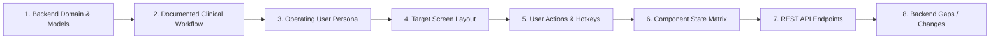

# Avinya HMS – Enterprise Hospital Frontend Master Specification
## Document `00_FRONTEND_MASTER_SPEC.md`
### The Definitive Architecture, Information Hierarchy, Patient-Centric Experience & Screen Blueprint

**Document Version:** `3.0.0-ENTERPRISE-SPEC`  
**Classification:** Enterprise Multi-Tenant Hospital Operating System (HMS / EMR / LIS / RIS / RCM / ERP)  
**System Boundary:** Hospital Clinical & Operational Front-End (`hospital-ui`) vs SaaS Fleet Control Plane (`onboarding-ui`)  
**Methodology:** Repository-Driven Gap Audit (`Backend Domain -> Workflow -> Persona -> Screens -> Actions -> States -> API -> Gaps`)  
**Target Environments:** Tertiary Hospitals, Multi-Specialty Medical Centers, Corporate Hospital Networks (50 to 1,500+ Beds)  

---

## 1. Executive Verdict & Core Paradigm Shift

The backend of Avinya HMS represents a mature, rigorous healthcare engine covering 26 clinical and operational domains with atomic locking, envelope encryption, and regulatory safety gates. However, previous UI attempts suffered from three critical architectural flaws:

1. **Control-Plane Conflation:** The system conflated SaaS fleet administration (tenant provisioning, database migration, canary deployments) with frontline hospital operations.
2. **Generic CRUD Forms vs Clinical User Journeys:** Hospital workflows were represented as flat tables and isolated forms rather than role-specific command cockpits and journey boards.
3. **Absence of Patient as the Central Object:** Encounters, lab results, prescriptions, vitals, and billing were treated as fragmented silos rather than facets of a unified, longitudinal patient record.

### The Two Distinct Products

```
                               ┌─────────────────────────────────────────────────────────────┐
                               │                     AVINYA HMS PLATFORM                     │
                               └──────────────────────────────┬──────────────────────────────┘
                                                              │
                    ┌─────────────────────────────────────────┴─────────────────────────────────────────┐
                    ▼                                                                                   ▼
┌───────────────────────────────────────┐                                           ┌───────────────────────────────────────┐
│     PRODUCT A: SAAS CONTROL PLANE     │                                           │     PRODUCT B: HOSPITAL CLINICAL OS   │
│         (Nexus Fleet Platform)        │                                           │        (Frontline Hospital Engine)    │
├───────────────────────────────────────┤                                           ├───────────────────────────────────────┤
│ • Avinya Super Admin & SREs           │                                           │ • Hospital CEO, COO & Medical Director│
│ • Cloud Infrastructure Operators      │                                           │ • Attending Physicians & Surgeons     │
│ • Tenant Provisioning & Onboarding    │                                           │ • Ward & Triage Nurses (eMAR, NEWS2)  │
│ • Cross-Tenant Database Migrations    │                                           │ • Outpatient Reception & Registration │
│ • S3 Disaster Recovery & Restore Drill│                                           │ • Central Pharmacy & NDPS Vault       │
│ • SaaS Subscription Plans & Stripe    │                                           │ • Diagnostic Pathology LIS & PACS     │
│ • Synthetic Sandbox Sanitization      │                                           │ • Cashier Billing, TPA Claims & RCM   │
│ • Global Audit Immutability Vault     │                                           │ • OT, Blood Bank, CSSD & Biomedical   │
└───────────────────────────────────────┘                                           └───────────────────────────────────────┘
```

---

## 2. Fundamental Architectural Tenets of the Hospital Application

### Tenet 1: The Patient as the Central Object
A patient record is not a row in a table. It is the core entity around which all clinical, financial, and operational events rotate:
- **Global Patient Context Spine:** When a patient is selected, their context remains anchored across all clinical modules. A physician reviewing a lab result, a nurse administering an IV infusion, and a billing clerk preparing a discharge folio operate on the **same active patient context** without redundant searches.
- **Longitudinal Patient Timeline:** A single chronological stream recording every event from registration to post-discharge follow-up:
  `Arrival -> Triage -> Vitals -> Consultation -> SOAP Note -> Diagnosis -> Orders -> Prescriptions -> Payment -> Phlebotomy -> LIS Result -> Verification -> Bedside Administration`.

### Tenet 2: The Duty Context & Multi-Branch Hierarchy
Hospital staff work across multiple physical facilities, departments, and shifts. Every session is explicitly contextualized:
```
[ Group: Apollo Hospitals ] ──> [ Hospital: Apollo Hyderabad ] ──> [ Branch: Jubilee Hills ] ──> [ Dept: Cardiology ] ──> [ Shift: Morning (07:00-15:00) ]
```
The application shell displays this duty context at all times, preventing cross-branch order errors or medication misallocations.

### Tenet 3: Distinct Workspaces by Clinical Persona
Nurses do not need doctor consultation editors; doctors do not need billing folio allocators; phlebotomists do not need bed assignment grids. The application enforces dedicated, role-tailored workstation experiences:
- **Doctor:** Clinical Cockpit, longitudinal EMR, SOAP editor, CPOE 1-click order sets, Clinical Decision Support (CDS) Radar.
- **Nurse:** "My Shift" dashboard, bed acuity board, time-slotted eMAR grid, bedside optical BCMA 5-rights verification, NEWS2 deterioration monitor, SBAR shift handover.
- **Front Desk:** Unified intake desk, fast-track OPD token generator, appointment scheduler, waiting room display board.
- **Emergency:** ESI 1–5 triage Kanban board, Glasgow Coma Scale calculator, trauma flow sheet, Code Red mass casualty activation.
- **Pharmacy:** Prescription queue, formulary dispensing, Schedule H1/X double-witness perpetual narcotics vault, FEFO batch manager.
- **Laboratory:** Phlebotomy accessioning queue, tube barcode printing, analyzer TCP/MLLP interface monitor, Panic Critical Delta protocol.
- **Billing & Finance:** Categorized folio aggregator, TPA cashless pre-auth split allocator, multi-tender receipting, GST tax invoicing.
- **Quality & Safety:** Clinical incident CAPA register, hospital-acquired infection tracker (CAUTI, CLABSI, VAP, SSI), NABH 5th / JCI 7th indicators.

### Tenet 4: Clear Separation of Information Horizons
```
┌───────────────────┬────────────────────────────────────────────────────────────────────────┐
│ Information Layer │ Core Question Answered & Operational Focus                             │
├───────────────────┼────────────────────────────────────────────────────────────────────────┤
│ 1. Work Queue     │ "Tell me what I need to do right now." (Tasks, Overdue meds, Unsigned) │
│ 2. Command Center │ "Tell me what is happening across the hospital right now." (Live census│
│ 3. Alerts Radar   │ "Tell me what requires immediate clinical attention." (Panic lab, Code)│
│ 4. Analytics      │ "Help me understand why it happened." (ALOS trends, RevPOB, Denials)  │
│ 5. Reports        │ "Show me the legal/statutory record of what happened." (Registers, Tax)│
└───────────────────┴────────────────────────────────────────────────────────────────────────┘
```

---

## 3. Verified Code Defects & Elimination Directives

The frontend master specification directly incorporates fixes for verified defects identified in repository test suites:

| ID | Category | Defect Description | Mandatory Specification Directive |
|---|---|---|---|
| **B-01** | High / UX | Typing phone fragment automatically opens patient record and wipes search box. | Auto-open is restricted strictly to exact match on complete `MRN-YYYYMM-XXXXXX` format. Partial phone/name searches populate dropdown suggestions without modifying input text. |
| **B-02** | High / A11Y | Keyboard focus escapes dialog modals (violates WAI-ARIA / A11Y-02). | All modals, drawers, and confirmation dialogs must implement strict focus trapping (`react-focus-lock` / HTML `<dialog>`) and return focus to triggering element upon dismissal. |
| **B-03** | Med / A11Y | Navigation items rendered as `<button>` instead of semantic `<a>`. | All navigable routes must use semantic `<a href="...">` wrapped in `<nav>` lists with `aria-current="page"`, enabling middle-click, open in new tab, and assistive screen reader discovery. |
| **B-04** | Med / Routing | Unknown routes (`#nonsense`) silently render default dashboard. | Route table must declare explicit 404 (Not Found) and 403 (Forbidden / Unlicensed) route boundaries with breadcrumb recovery. |
| **C-01** | High / Date | Timestamps use local browser zone instead of tenant hospital zone. | All UI date/time displays must format via a centralized tenant-aware temporal utility reading the hospital's IANA time zone (e.g., `Asia/Kolkata`). |
| **C-02** | High / RCM | Billing hand-off creates invoice and adds line-items across separate unlinked calls. | Transactional atomic billing: Frontend checks for active encounter folio before invoice generation; line-item additions are bundled into a single atomic payload. |
| **C-03** | High / State | Session expiration mid-form discards user input and redirects to login. | Persistent draft storage in IndexedDB/sessionStorage; in-place re-authentication modal preserving active clinical form state upon 401 token refresh. |
| **C-04** | Med / MPI | Duplicate patient detection evaluates phone numbers only. | Multi-factor weighted fuzzy matching: Phone (40%) + Full Name Levenshtein (30%) + Date of Birth (20%) + Gender (10%) with similarity score ranking. |
| **C-05** | Med / Network | Polling status history of every waiting patient triggers request storm (40+ calls / 20s). | Backend aggregate endpoint (`GET /v1/api/opd/queue-summary`) delivering consolidated queue status in a single unified payload. |
| **C-06** | Med / ADT | Appointment conflict check is shallow (fixed ±15 mins, ignoring planned durations). | Real interval collision check: `[start_time, start_time + duration_minutes]` checked against doctor schedule, room availability, and leave ledger. |
| **C-07** | Med / Stability| Single React rendering error blanks the entire application viewport. | Multi-tier Error Boundaries: Global App Boundary -> Workspace Boundary -> Widget/Tab Boundary with graceful failure recovery cards. |
| **C-08** | Med / RBAC | Permission hints show buttons that return 403 because unknown roles are treated as allowed. | Strict fail-closed capability evaluation: actions require explicit permission code in authenticated JWT claim array; unknown roles default to zero capabilities. |

---

## 4. The 42-Document Frontend Architecture Blueprint

The complete frontend specification is organized into 42 exhaustive technical manuals under `docs/frontend/`:

```
docs/frontend/
├── 00_FRONTEND_MASTER_SPEC.md              <-- This Document (Vision, Tenets & Gap Audit Strategy)
├── 01_INFORMATION_ARCHITECTURE.md          <-- Universal Sitemap, Hierarchy, Route Tables & Navigation
├── 02_APPLICATION_SHELL.md                 <-- Header, Duty Context, Global Search, Task Spine, Footer
├── 03_NAVIGATION_MODEL.md                  <-- Role-Gated Sidebar, Keyboard Hotkeys, Mobile Rails
├── 04_ROLE_AND_PERSONA_MODEL.md            <-- 14 Hospital Personas, Capability Matrix & RBAC Session Binding
├── 05_SCREEN_INVENTORY.md                  <-- Complete Catalog of all 84 Hospital Screens & Routes
├── 06_USER_JOURNEYS.md                     <-- 12 End-to-End Clinical & Operational User Journeys
├── 07_WORKFLOW_STATES.md                   <-- The 8 Universal Component States (Loading, Empty, Error...)
├── 08_PATIENT_EXPERIENCE.md                <-- Global Patient Context, Longitudinal Timeline, Demographic MDM
├── 09_OPD_UX.md                            <-- Fast-Track Intake, Waiting Board, Doctor Queue, Display Board
├── 10_IPD_ADT_UX.md                        <-- 500+ Bed Board Matrix, Transfer Wizard, 3-Tier Discharge Gate
├── 11_EMERGENCY_UX.md                      <-- ESI 1-5 Kanban, GCS Calculator, Code Red Disaster Board
├── 12_CLINICAL_EMR_UX.md                   <-- Doctor Cockpit, SOAP Editor, CPOE Order Sets, CDS Radar
├── 13_NURSING_UX.md                        <-- "My Shift", eMAR Schedule, BCMA 2D Scan, NEWS2, SBAR Handover
├── 14_PHARMACY_UX.md                       <-- Formulary Dispensing, NDPS Schedule H1 Vault, FEFO Expiry
├── 15_LAB_UX.md                            <-- Phlebotomy Accessioning, Panic Critical Delta Protocol, Analyzers
├── 16_RADIOLOGY_UX.md                      <-- DICOM PACS Web Viewer, Modality Worklist, Transcription
├── 17_SURGERY_UX.md                        <-- OT Master Schedule, PAC Clearance, WHO Surgical Checklist
├── 18_BLOOD_BANK_UX.md                     <-- Donor Screening, Cross-Matching, Component Inventory Ledger
├── 19_BILLING_FINANCE_UX.md                <-- Folio Aggregation, Multi-Tender Receipting, GST Invoicing, AP/AR
├── 20_INSURANCE_RCM_UX.md                  <-- TPA Pre-Auth Case Manager, Cashless Split, Claim Adjudication
├── 21_INVENTORY_PROCUREMENT_UX.md          <-- PO Lifecycle, 3-Way GRN Match, Stock Transfers, Wastage
├── 22_WORKFORCE_UX.md                      <-- Staff Roster, Attendance, Statutory Payroll Lockouts (PF/ESI/TDS)
├── 23_QUALITY_SAFETY_UX.md                 <-- Adverse Incident CAPA, Hospital Infection Benchmarks (CAUTI/SSI)
├── 24_COMPLIANCE_PRIVACY_UX.md             <-- DPDP Section 6 Consents, Data Rights Requests, Breach Forensics
├── 25_REPORTING_UX.md                      <-- Statutory Clinical Registers, Shift Collections, CSV/PDF Export
├── 26_ANALYTICS_UX.md                      <-- 700+ Multidimensional KPI Cube Explorer, RevPOB, ALOS Engine
├── 27_NOTIFICATION_TASK_UX.md              <-- "My Work" Unified Task Inbox, Clinical Escalation Alerts
├── 28_SEARCH_UX.md                         <-- Global Universal Omnibox Search (Cmd+K) & Deep Indexing
├── 29_SETTINGS_ADMIN_UX.md                 <-- Hospital Master & Facility Builder (Beds, Doctors, Tariffs)
├── 30_CONTROL_PLANE_UX.md                  <-- Nexus Fleet Console Integration Boundary
├── 31_DESIGN_SYSTEM.md                     <-- Visual Design Tokens, Typography, Contrast, Color Palettes
├── 32_COMPONENT_INVENTORY.md               <-- Catalog of 60 Standard Clinical UI Atoms, Molecules & Organisms
├── 33_TABLE_PATTERNS.md                    <-- High-Density Data Grids, Virtualization, Sorting & Filtering
├── 34_FORM_PATTERNS.md                     <-- Clinical Input Validation, Steppers, Autosave, Draft Recovery
├── 35_ERROR_STATE_PATTERNS.md              <-- Non-Disruptive Warnings, Hard Clinical Stops, Break-Glass Dialogs
├── 36_ACCESSIBILITY.md                     <-- WCAG 2.1 AA Compliance, Screen Readers, Keyboard Focus Trapping
├── 37_RESPONSIVE_BEHAVIOR.md               <-- Multi-Screen Responsiveness: Desktop Workstation, Tablet, Mobile
├── 38_API_TO_SCREEN_MAPPING.md             <-- Exhaustive Matrix Mapping Every Screen to FastAPI Endpoints
├── 39_BACKEND_GAP_ANALYSIS.md              <-- Detailed Inventory of Missing APIs & Data Fields in Backend
├── 40_FRONTEND_ACCEPTANCE_CRITERIA.md      <-- Rigorous QA Pass/Fail Criteria for Every Operational Screen
└── 41_E2E_WORKFLOW_TEST_MATRIX.md          <-- Automated Playwright / Cypress End-to-End Test Matrix
```

---

## 5. Repository-Driven Gap Audit Methodology

To guarantee that the frontend reflects the real capabilities of the Avinya HMS backend without hallucinated features or unbuildable gaps, every screen specification is anchored to this audit pipeline:



### Gap Audit Schema:
1. **Domain & Backend Anchor:** Relational models, tables, and constraints in `backend/domains/`.
2. **Clinical Objective:** What real-world medical or operational goal this screen achieves.
3. **Primary & Secondary Personas:** Which hospital staff roles interact with the screen.
4. **Required Information Elements:** Exact data fields displayed and collected.
5. **Operational State Machine:** Component behavior across Loading, Empty, Partial, Active, Error, Forbidden, Unlicensed, and Stale states.
6. **API Contracts:** Exact HTTP methods, endpoints, request payloads, and query parameters.
7. **Identified Backend Gaps:** Any missing aggregate endpoints, missing enum values, or required schema extensions needed to power the frontend cleanly.

