# Avinya HMS – Information Architecture & Universal Sitemap
## Document `01_INFORMATION_ARCHITECTURE.md`
### Master Route Tree, Information Hierarchy, Role-Gated Access & Deep-Linking Standards

**Document Version:** `3.0.0-ENTERPRISE-SPEC`  
**Classification:** Enterprise Multi-Tenant Hospital Operating System  
**Parent Document:** [`00_FRONTEND_MASTER_SPEC.md`](00_FRONTEND_MASTER_SPEC.md)  

---

## 1. Universal Route Hierarchy & URL Standard

Every URL in Avinya HMS is deterministic, bookmarkable, and strictly bound to the authenticated tenant slug and duty context:

```
https://<tenant_slug>.avinyahms.com/<module>/<sub_resource>/<entity_id>?<filters>
```

### Route Nomenclature Conventions:
- **Kebab-case** for multi-word paths (`/patients/new`, `/emergency-triage`, `/blood-bank`).
- **Semantic Resource Identifiers:** Uses canonical clinical identifiers where possible (e.g. `/patients/AV-2026-00412` or numeric ID `/patients/412`).
- **Standardized Query Parameters:**
  - `tab` — Active sub-view or tab (`?tab=timeline`, `?tab=medications`, `?tab=billing`).
  - `status` — Filter status (`?status=occupied`, `?status=pending_clearance`).
  - `date` — ISO-8601 target date (`?date=2026-11-01`).
  - `department` / `ward` / `doctor` — Duty context scopes (`?ward=icu-1`, `?doctor=42`).

---

## 2. Complete Enterprise Hospital Sitemap (84 Screens across 15 Modules)

```mermaid
graph TD
    ROOT["App Root (/)"] --> PUBLIC["1. Public & Auth Gate"]
    ROOT --> WORKSPACE["2. Role Workspaces (Home & Tasks)"]
    ROOT --> PATIENT_CORE["3. Universal Patient Spine (/patients/:mrn)"]
    ROOT --> OPD["4. Outpatient Workflows (/opd/*)"]
    ROOT --> IPD["5. Inpatient ADT & Bed Board (/ipd/*)"]
    ROOT --> ED["6. Emergency Department (/emergency/*)"]
    ROOT --> CLINICAL["7. Clinical Cockpit & EMR (/clinical/*)"]
    ROOT --> NURSING["8. Ward Nursing & eMAR (/nursing/*)"]
    ROOT --> PHARMACY["9. Pharmacy & NDPS Vault (/pharmacy/*)"]
    ROOT --> LAB["10. Laboratory LIS & PACS (/diagnostics/*)"]
    ROOT --> SURGERY["11. Surgery & OT (/surgery/*)"]
    ROOT --> BLOOD["12. Blood Bank (/blood-bank/*)"]
    ROOT --> BILLING["13. Billing, Finance & TPA (/billing/*)"]
    ROOT --> SUPPLY["14. Procurement & Inventory (/supply/*)"]
    ROOT --> GOV["15. Quality, Privacy & Admin (/governance/*)"]
```



---

## 3. Exhaustive Screen & Route Directory

### Module 1: Public, Security & Auth Gateways
| Route | Screen Name | Description & Key Capabilities | Required Role / Permission |
|---|---|---|---|
| `/login` | Staff Sign-In Portal | Password authentication with hospital tenant slug selector. | Public |
| `/mfa` | MFA TOTP Challenge | RFC 6238 6-digit rolling code challenge with single-use recovery code fallback. | Public (Challenge token) |
| `/forgot-password` | Password Recovery Request | Work email input triggering single-use cryptographic reset link. | Public |
| `/reset-password` | Set New Password | Form validating password complexity (12+ chars, special char, number). | Public (Reset token) |
| `/session-expired` | Session Timeout Modal | In-place re-authentication preserving active unsaved form data. | Public (Expired session) |
| `/403` | Forbidden & Unlicensed | Clear message stating missing role, capability, or tenant license module. | Authenticated |
| `/404` | Resource Not Found | Semantic missing route screen with breadcrumbs and search jump. | Authenticated |

### Module 2: Role Workspaces & Personal Cockpits
| Route | Screen Name | Description & Key Capabilities | Required Role / Permission |
|---|---|---|---|
| `/home` | Role-Specific Home Cockpit | Automatically redirects to persona home (Doctor Dashboard, Nurse Station, Cashier Desk). | Authenticated |
| `/tasks` | "My Work" Unified Task Center | Aggregated task inbox: unsigned notes, overdue meds, pending lab approvals, disputed claims. | Authenticated |
| `/notifications` | Clinical & System Alerts | High-priority clinical radar: panic lab notifications, code blues, drug recalls. | Authenticated |

### Module 3: Universal Patient Spine & Longitudinal Record
| Route | Screen Name | Description & Key Capabilities | Required Role / Permission |
|---|---|---|---|
| `/patients` | Master Patient Index (MPI) | Deduplicated patient registry with multi-factor search (Name, Phone, ABHA, MRN). | `patients:read` |
| `/patients/new` | Patient Registration Wizard | Demographic intake, Indian PIN code lookup, ABHA link, Section 6 consent, thermal wristband. | `patients:write` |
| `/patients/:mrn` | Patient 360 Header & Overview | Core patient spine: vital indicators, active admission, current encounter, alerts. | `patients:read` |
| `/patients/:mrn/timeline` | Longitudinal Care Timeline | Unified chronological event stream (Arrival -> Vitals -> SOAP -> Labs -> Meds -> Bill). | `clinical:read` |
| `/patients/:mrn/clinical` | Problem List & Diagnoses | Active ICD-10 chronic & acute diagnoses, surgical history, family history. | `clinical:read` |
| `/patients/:mrn/vitals` | Vital Signs & NEWS2 Graph | Longitudinal hemodynamic trend graphs (BP, HR, SpO2, Temp, RR) with NEWS2 acuity. | `vitals:read` |
| `/patients/:mrn/medications` | Active Medication Profile | Current prescriptions, home meds, past adverse drug reactions, allergies. | `pharmacy:read` |
| `/patients/:mrn/orders` | CPOE Diagnostic Orders | History of laboratory, radiology, and procedure orders with live status tracking. | `cpoe:read` |
| `/patients/:mrn/results` | Lab & Radiology Reports | Pathologist-verified lab results with delta indicators and embedded DICOM PACS viewer. | `diagnostics:read` |
| `/patients/:mrn/encounters` | Past Encounters History | Archive of all OPD visits, IPD admissions, and emergency visits. | `encounters:read` |
| `/patients/:mrn/billing` | Patient Folio & Statement | Running itemized ledger, deposits, insurance coverage, and outstanding balances. | `billing:read` |
| `/patients/:mrn/consents` | DPDP Consent Artifacts | History of signed consents under DPDP Act 2023 with purpose revocation actions. | `privacy:read` |
| `/patients/:mrn/audit` | Chart Access Audit Trail | Immutable log of every clinical staff member who viewed or edited this patient's chart. | `audit:read` |

### Module 4: Outpatient Department (OPD) Workflows
| Route | Screen Name | Description & Key Capabilities | Required Role / Permission |
|---|---|---|---|
| `/opd/today` | OPD Command Dashboard | Real-time arrival rates, waiting time averages, doctor workload metrics, queue delays. | `opd:read` |
| `/opd/queue` | Live OPD Queue Board | Department & doctor queue visualizer: Waiting, In Consultation, Completed, No-Show. | `opd:read` |
| `/opd/appointments` | Appointment Schedule Grid | Multi-doctor slot calendar with conflict warnings, leave overlays, and booking dialogs. | `opd:read` |
| `/opd/appointments/new` | Appointment Booking Wizard | Doctor selection, specialty filtering, slot booking, initial fee collection, token issue. | `opd:write` |
| `/opd/check-in` | Fast-Track Arrival Desk | Instant patient check-in, identity verification, thermal queue slip printing. | `opd:write` |
| `/opd/walk-in` | Walk-In Triage & Allocation | Urgent outpatient walk-in registration with automated queue slot insertion. | `opd:write` |
| `/opd/waitlist` | Waitlist Management | Unmet demand queue with automated slot conversion upon cancellation. | `opd:read` |
| `/opd/leaves` | Doctor Leave Ledger | Clinician absence calendar preventing scheduling collisions on planned leave days. | `opd:write` |
| `/opd/unmet-demand` | Service Demand Backlog | Logging unavailable specialties, equipment gaps, and community demand. | `analytics:read` |
| `/opd/display` | Waiting Room Public Display | High-contrast TV display showing currently called token numbers per consultation chamber. | Public / Reception |

### Module 5: Inpatient ADT, Bed Matrix & Discharges
| Route | Screen Name | Description & Key Capabilities | Required Role / Permission |
|---|---|---|---|
| `/ipd/beds` | Visual Bed Board Matrix | Multi-scale bed grid: Towers -> Floors -> Wards -> Beds with live status filters. | `adt:read` |
| `/ipd/admissions` | Inpatient Census List | Active hospitalized patients, attending consultants, admitting diagnoses, LOS. | `adt:read` |
| `/ipd/admissions/new` | Admission Wizard | MPI lookup, bed reservation (FOR UPDATE NOWAIT), MLC check, TPA pre-auth link. | `adt:write` |
| `/ipd/transfers` | Bed & Ward Transfer Desk | Inter-ward patient transfers, clinical handover notes, room tariff step-ups/step-downs. | `adt:write` |
| `/ipd/discharge-board` | 3-Tier Discharge Clearance Gate | Real-time bottleneck board: Clinical Sign-off (✓), Pharmacy Clearance (✓), Billing (✓). | `adt:read` |
| `/ipd/discharges/:id` | Discharge Clearance Console | Execution workspace for authorizing clinical summary, drug returns, and folio settlement. | `discharge:write` |
| `/ipd/census-runner` | Midnight Census Audit | Daily automated room rent and nursing charge audit run with manual reconciliation. | `billing:admin` |

### Module 6: Emergency Department (ED / Triage)
| Route | Screen Name | Description & Key Capabilities | Required Role / Permission |
|---|---|---|---|
| `/emergency/board` | Emergency Triage Board | ESI 1–5 Kanban lanes (Resuscitation, Emergent, Urgent, Less Urgent, Non-Urgent). | `emergency:read` |
| `/emergency/triage/new` | Rapid Triage Intake | ESI calculator, Glasgow Coma Scale (GCS), chief complaint, trauma mechanism. | `emergency:write` |
| `/emergency/trauma-flow` | Trauma Resuscitation Flowsheet | Fast documentation of airway, breathing, circulation, blood products, and procedures. | `emergency:write` |
| `/emergency/mlc` | Medico-Legal Case (MLC) Desk | Section 39 CrPC police notification generator, injury documentation, chain of custody. | `mlc:write` |
| `/emergency/code-red` | Mass Casualty Disaster Console | 1-click disaster tag generator (`DISASTER-001` to `999`), bed override, hospital alert. | `emergency:admin` |

### Module 7: Clinical Cockpit & Doctor Consultation
| Route | Screen Name | Description & Key Capabilities | Required Role / Permission |
|---|---|---|---|
| `/clinical/cockpit` | Doctor Consultation Chamber | Active encounter queue, incoming patient call button, quick clinical summary. | `clinical:write` |
| `/clinical/encounters/:id` | SOAP Consultation Workspace | Subjective, Objective, Assessment (ICD-10), Plan, CPOE Order Sets, CDS Safety Radar. | `clinical:write` |
| `/clinical/cpoe` | CPOE Fast Order Builder | 1-click evidence-based order sets (ACS Chest Pain, Stroke, Sepsis, Pre-Op). | `cpoe:write` |
| `/clinical/templates` | Clinical Documentation Templates | Custom departmental clinical note templates, macros, and examination checklists. | `clinical:write` |

### Module 8: Ward Nursing Station & Bedside eMAR
| Route | Screen Name | Description & Key Capabilities | Required Role / Permission |
|---|---|---|---|
| `/nursing/station` | "My Shift" Nursing Station | Assigned bed list, acuity levels, shift tasks, vital checks due, IV infusions. | `nursing:read` |
| `/nursing/emar` | Electronic MAR Visual Grid | Timetable of scheduled doses (08:00, 12:00, 16:00, 20:00) with status colors. | `nursing:write` |
| `/nursing/bcma` | Bedside BCMA Optical Scan | Enforces 5 Rights via barcode scanner: Patient Wristband -> Medication Ampoule -> Dose. | `nursing:write` |
| `/nursing/vitals-entry` | Bedside Vitals & NEWS2 Entry | Rapid hemodynamic data entry with automated NEWS2 calculation and RRT alert. | `vitals:write` |
| `/nursing/sbar` | Shift Handover Kardex | Situation, Background, Assessment, Recommendation structured inter-shift report. | `nursing:write` |

### Module 9: Central Pharmacy & NDPS Narcotics Vault
| Route | Screen Name | Description & Key Capabilities | Required Role / Permission |
|---|---|---|---|
| `/pharmacy/queue` | Outpatient & Inpatient Rx Queue | Real-time CPOE prescription orders, formulary stock checks, generic substitution. | `pharmacy:read` |
| `/pharmacy/dispense/:id` | Medication Dispensing Desk | Batch selection, FEFO enforcement, barcode scan verification, patient label printing. | `pharmacy:write` |
| `/pharmacy/returns` | Ward Drug Returns & Credits | Inspection of unconsumed ward medication returns with automated invoice credit note. | `pharmacy:write` |
| `/pharmacy/vault` | Schedule H1 & X Narcotics Vault | Perpetual double-witness ledger, dual clinician login, daily physical count audits. | `pharmacy:vault` |
| `/pharmacy/stock` | Inventory & Expiry Surveillance | Stock on hand, reorder thresholds, near-expiry alerts (30/60/90 days), cold-chain alerts. | `pharmacy:read` |

### Module 10: Diagnostic Laboratory (LIS) & Radiology (RIS/PACS)
| Route | Screen Name | Description & Key Capabilities | Required Role / Permission |
|---|---|---|---|
| `/diagnostics/phlebotomy` | Phlebotomy Accessioning Desk | Specimen draw worklist, Code-128 specimen tube barcode label printing. | `lab:write` |
| `/diagnostics/worklist` | Laboratory Analyzer Worklist | Ingested HL7 MLLP analyzer feeds, pending tests, manual result entry matrix. | `lab:read` |
| `/diagnostics/verify/:id` | Pathologist Verification | Delta check baseline review, panic threshold alerts, digital pathologist sign-off. | `lab:verify` |
| `/diagnostics/panic` | Panic Critical Value Register | Urgent lab panic alerts requiring documented telephone read-back within 15 minutes. | `lab:write` |
| `/diagnostics/radiology` | Radiology Modality Worklist | X-Ray, CT, MRI, Ultrasound schedule, DICOM accessioning numbers. | `radiology:read` |
| `/diagnostics/pacs/:id` | Integrated DICOM PACS Viewer | Zero-footprint web PACS viewer: window/leveling, pan, zoom, Cobb angle, transcription. | `radiology:read` |

### Module 11: Operating Theatre & Surgical Suite
| Route | Screen Name | Description & Key Capabilities | Required Role / Permission |
|---|---|---|---|
| `/surgery/schedule` | OT Master Schedule Board | Visual timeline across all operating theatres, anesthesia teams, surgical scrub teams. | `surgery:read` |
| `/surgery/cases/new` | Surgery Booking & PAC Desk | Pre-Anesthetic Checkup clearance, surgical consent capture, blood product cross-match. | `surgery:write` |
| `/surgery/cases/:id` | Intra-Operative Surgical Record | WHO Surgical Safety Checklist (Sign In, Time Out, Sign Out), surgical consumables log. | `surgery:write` |

### Module 12: Blood Bank & Transfusion Medicine
| Route | Screen Name | Description & Key Capabilities | Required Role / Permission |
|---|---|---|---|
| `/blood-bank/donors` | Voluntary Donor Registry | Donor screening, viral serology (HIV, Hepatitis B/C, Syphilis, Malaria), bleeding log. | `bloodbank:write` |
| `/blood-bank/inventory` | Blood Component Stock Ledger | Real-time units of PRBC, FFP, Platelets, Cryoprecipitate with expiration tracking. | `bloodbank:read` |
| `/blood-bank/crossmatch` | Cross-Matching & Issue Desk | Compatibility testing, patient transfusion requisitions, bedside verification slips. | `bloodbank:write` |

### Module 13: Cashier Counter, Billing & Insurance RCM
| Route | Screen Name | Description & Key Capabilities | Required Role / Permission |
|---|---|---|---|
| `/billing/invoices` | Patient Billing & Folios | Itemized folios: Bed Rent, Nursing, Doctors, Surgery, Pharmacy, Labs, Implants. | `billing:read` |
| `/billing/cashier` | Cashier Counter & Payment Desk | Multi-tender payment capture (Cash, Card, UPI, Bank Transfer), GST tax invoicing. | `billing:write` |
| `/billing/deposits` | Advance Deposits & Drawdown | Inpatient advance collections, automatic drawdown against charges, refund vouchers. | `billing:write` |
| `/billing/closing` | Shift Settlement & Cash Reconcile | Cashier end-of-shift reconciliation: physical cash vs system ledger, blind closing. | `billing:write` |
| `/billing/insurance` | TPA Pre-Authorization Manager | Insurer pre-auth limits, enhancement requests, cashless approval letters. | `insurance:write` |
| `/billing/claims` | NHCX Electronic Claims Desk | National Health Claims Exchange claim submission, query resolution, adjudication. | `insurance:write` |

### Module 14: Procurement, Inventory & Supply Chain
| Route | Screen Name | Description & Key Capabilities | Required Role / Permission |
|---|---|---|---|
| `/supply/requisitions` | Purchase Requisition Desk | Departmental supply requests, approval workflows, budget validations. | `supply:write` |
| `/supply/purchase-orders` | Purchase Order (PO) Manager | PO generation, vendor dispatch, price negotiation, terms agreements. | `supply:write` |
| `/supply/grn` | Goods Receipt Notes (GRN) | 3-way matching (PO vs Delivery Challan vs Invoice), ClamAV attachment scanning. | `supply:write` |
| `/supply/stock-transfers`| Departmental Stock Issues | Central store to ward/pharmacy issues, returns, wastage logs. | `supply:write` |

### Module 15: Quality, Compliance & Master Administration
| Route | Screen Name | Description & Key Capabilities | Required Role / Permission |
|---|---|---|---|
| `/governance/incidents` | Adverse Incident Register | Clinical near-misses, sentinel events, Root Cause Analysis (RCA), CAPA tracker. | `quality:write` |
| `/governance/indicators`| NABH & JCI Quality Radar | Automated clinical indicators: CAUTI, CLABSI, VAP, SSI, Falls, Med Errors, Unplanned ICU. | `quality:read` |
| `/governance/privacy` | DPDP Act 2023 Privacy Portal | Data principal access/erasure requests, grievance redressal, breach notification log. | `privacy:write` |
| `/governance/audit` | Master Security Audit Vault | SIEM export, break-glass override register, tamper-proof user activity forensics. | `audit:read` |
| `/governance/reports` | Statutory Reports & Registers | OPD/IPD registers, Medico-Legal registers, midnight census logs, GST tax returns. | `reports:read` |
| `/governance/analytics`| Executive KPI Cube Explorer | 700+ Multidimensional metric cubes, Bed Turnover, RevPOB, AR Aging, Denial Rate. | `analytics:read` |
| `/admin/facility` | Master Facility Builder | Campuses, Towers, Floors, Wards, Dynamic Bed Matrix & Room Tariffs. | `admin:facility` |
| `/admin/doctors` | Doctor Roster & Pricing Master | Clinicians, NMC registrations, specialties, OPD/IPD consultation fees. | `admin:doctors` |
| `/admin/identity` | Hospital Identity & Letterhead | Legal name, NABH/JCI IDs, ROHINI code, emergency hotlines, branding logos. | `admin:identity` |
| `/admin/policies` | Statutory Hospital Policies | MLC enforcement, mandatory ABHA, dual-witness narcotics, 3-tier discharge rules. | `admin:policies` |
| `/admin/access` | IAM & Role Management | User accounts, department assignments, granular capability permissions, MFA reset. | `admin:users` |

