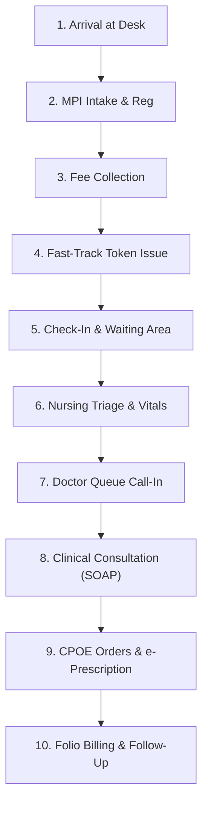

# Avinya HMS – Outpatient Department (OPD) Workflows & UX
## Document `09_OPD_UX.md`
### The Complete Ambulatory Care Journey, Fast-Track Intake, Multi-Doctor Queue Cockpit & Display Board

**Document Version:** `3.0.0-ENTERPRISE-SPEC`  
**Classification:** Enterprise Multi-Tenant Hospital Operating System  
**Parent Document:** [`00_FRONTEND_MASTER_SPEC.md`](00_FRONTEND_MASTER_SPEC.md)  

---

## 1. Executive Summary & OPD Architectural Mission

The Outpatient Department (OPD) is the primary revenue and intake gateway of the hospital. A high-throughput tertiary facility handles between 800 and 4,000 ambulatory consultations daily across 20+ specialized clinical departments.

Traditional software creates massive friction: patients wait in separate queues for registration, doctor appointment booking, fee collection, triage, and consultation, frequently resulting in lost patients, queue jumping, and doctor schedule chaos.

Avinya HMS provides an **integrated OPD execution cockpit** that unifies the entire ambulatory journey from arrival to discharge.

---

## 2. The 10-Stage Outpatient Lifecycle State Machine



---

## 3. OPD Workspaces & Screen Specifications

### 3.1 OPD Command Dashboard (`/opd/today`)
A high-level command console for Outpatient Nursing Supervisors and Medical Superintendents:
- **Real-Time Arrival Metrics:** Total Registered, Waiting, In-Consultation, Completed, No-Show, Walk-In.
- **SLA Breach Radar:** Highlights patients waiting $>45$ minutes past scheduled appointment time.
- **Doctor Workload Matrix:** Active consulting clinicians, average consult duration (e.g. 11.4 mins), pending chamber queues.

```
┌ OPD COMMAND DASHBOARD (01-NOV-2026 | Morning Shift) ──────────────────────────────────────────────────┐
│ TOTAL REGISTERED: 342  │  WAITING: 48  │  IN CONSULT: 14  │  COMPLETED: 276  │  SLA BREACHES: 4       │
├────────────────────────┬───────────────┬──────────────────┬──────────────────┬────────────────────────┤
│ CLINICAL DEPARTMENT    │ ACTIVE DOCTORS│ PATIENTS WAITING │ AVG WAIT TIME    │ STATUS                 │
│ Cardiology             │ 3 Doctors     │ 14 Patients      │ 18 mins          │ ● NORMAL               │
│ Neurology              │ 2 Doctors     │ 8 Patients       │ 24 mins          │ ● NORMAL               │
│ Orthopedics            │ 4 Doctors     │ 19 Patients      │ 48 mins          │ ▲ SLA WARNING (>45m)   │
│ Pediatrics             │ 2 Doctors     │ 7 Patients       │ 12 mins          │ ● NORMAL               │
└────────────────────────┴───────────────┴──────────────────┴──────────────────┴────────────────────────┘
```

---

### 3.2 Live Multi-Doctor Queue Cockpit (`/opd/queue`)
A dynamic drag-and-drop or 1-click status board used by chamber nursing attendants:
- **Queue Lanes:**
  - `Scheduled & Arrived` (Waiting in main lobby).
  - `Triaged (Vitals Done)` (Ready for doctor).
  - `In Consultation (Chamber)` (Currently with physician).
  - `Diagnostics / Lab Transit` (Sent for STAT ECG/Blood, returning to queue).
  - `Completed & Checked Out`.
- **Fast Actions per Patient:**
  - `[Call Patient]` (Triggers audible chime on Waiting Room TV Display).
  - `[Transfer Queue]` (Move to another doctor if consultant is called for surgery).
  - `[Mark No-Show]` (Flags patient as missed appointment).

---

### 3.3 Fast-Track Registration & Intake Desk (`/opd/check-in`)
The frontline intake workstation uniting registration, doctor selection, and token printing into a 30-second workflow:
1. **Demographic Entry:** First Name, Last Name, Phone Number, Date of Birth, Gender, Address with Indian PIN code auto-fill.
2. **Attending Doctor Picker:** Displays available clinicians for the day, active room numbers, and consultation fees (e.g. `Dr. Ramesh Gupta - Room 104 - Fee: ₹800`).
3. **Multi-Tender Cashiering:** Instant collection of registration and consultation fees (Cash / UPI QR code / Credit Card).
4. **Thermal Printer Dispatch:** Simultaneously fires two print jobs to hardware:
   - 2-inch continuous thermal barcode queue slip (`TOKEN-CARDIO-14`).
   - 2D Datamatrix patient wristband (`MRN-2026-00412`).

---

### 3.4 Public Waiting Room Display Screen (`/opd/display`)
A zero-navigation, high-contrast TV display designed for waiting room monitors:
- **Audio Chime:** Synthesized voice announcement in English and regional languages (`"Token 14, please proceed to Cardiology Chamber 4"`).
- **Visual Display:**
  ```
  ┌────────────────────────────────────────────────────────────────────────┐
  │                           AVINYA HMS OPD QUEUE                         │
  ├──────────────┬──────────────────┬──────────────┬───────────────────────┤
  │ TOKEN NUMBER │ PATIENT NAME     │ DEPARTMENT   │ CONSULTATION ROOM     │
  ├──────────────┼──────────────────┼──────────────┼───────────────────────┤
  │ CARDIO-14    │ DOE, J***        │ Cardiology   │ Chamber 4 (Dr. Gupta) │
  │ NEURO-08     │ RAO, K***        │ Neurology    │ Chamber 2 (Dr. Verma) │
  │ ORTHO-22     │ SINGH, M***      │ Orthopedics  │ Chamber 7 (Dr. Khan)  │
  └──────────────┴──────────────────┴──────────────┴───────────────────────┘
  ```

---

## 4. Network Storm Prevention (Resolving Defect C-05)

In legacy implementations, client boards polled the status history of every individual waiting patient, generating up to 40 HTTP requests every 20 seconds.

Avinya HMS replaces per-patient polling with a **Consolidated Queue Summary API**:
- **Endpoint:** `GET /v1/api/opd/queue-summary?department_id=4&date=2026-11-01`
- **Response Payload:** Delivers the consolidated list of all active tokens, waiting intervals, triage status, and assigned rooms in a single unified JSON response (cached via Redis Pub/Sub with 5-second delta invalidation).

