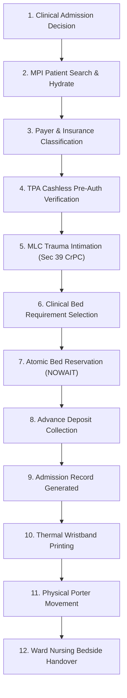

# Avinya HMS – Inpatient Admission, Bed Matrix (ADT) & Discharge Gate
## Document `10_IPD_ADT_UX.md`
### 500+ Bed Scale Matrix, Multi-Tower Hierarchy, Pessimistic Locking & 3-Tier Discharge Board

**Document Version:** `3.0.0-ENTERPRISE-SPEC`  
**Classification:** Enterprise Multi-Tenant Hospital Operating System  
**Parent Document:** [`00_FRONTEND_MASTER_SPEC.md`](00_FRONTEND_MASTER_SPEC.md)  

---

## 1. Executive Overview & IPD Architecture

Inpatient care governs the admission, physical bed allocation, inter-ward transfers, daily midnight census charging, and discharge of admitted hospital patients.

In a 500+ bed tertiary hospital, managing bed occupancy without visual clarity leads to disastrous bottlenecks: clean beds sit empty because housekeeping status is unrecorded; emergency patients wait in corridors while beds are double-allocated; and patients spend 8+ hours waiting on discharge day due to uncoordinated pharmacy and billing clearances.

Avinya HMS addresses this with two core operational cockpits:
1. **The Multi-Scale Visual Bed Board (`/ipd/beds`)**
2. **The Three-Tier Discharge Clearance Gate Board (`/ipd/discharge-board`)**

---

## 2. The Multi-Scale Visual Bed Board (`/ipd/beds`)

The Bed Board accommodates hospital scales from 50 to 1,500+ beds without browser lag, infinite scrolling, or DOM freezing. It uses a **4-tier physical hierarchy**:

```
[ Campus / Tower ] ──> [ Floor / Wing ] ──> [ Ward / Unit ] ──> [ Individual Bed Node ]
```

```
┌ VISUAL BED BOARD MATRIX (Total Beds: 520 | Occupied: 438 [84.2%] | Available: 46 | Cleaning: 22 | Maint: 14) ──┐
├───────────────────────────────────────────────────────────────────────────────────────────────────────────────┤
│ FILTERS: Tower: [Main Block v] | Floor: [2nd Floor v] | Ward: [Coronary Care Unit v] | Acuity: [ICU/CCU v]    │
├───────────────────────────────────────────────────────────────────────────────────────────────────────────────┤
│ WARD: CORONARY CARE UNIT (CCU) - 2ND FLOOR MAIN TOWER (12 Beds)                                               │
│                                                                                                               │
│ ┌ CCU-201 ──────────┐  ┌ CCU-202 ──────────┐  ┌ CCU-203 ──────────┐  ┌ CCU-204 ──────────┐                   │
│ │ ● OCCUPIED        │  │ ● OCCUPIED        │  │ ◌ AVAILABLE        │  │ ◈ CLEANING        │                   │
│ │ Rao, K. (62M)     │  │ Mehta, S. (54F)   │  │ Tariff: ₹12,000/day│  │ Bed Sanitization  │                   │
│ │ Adm: 28-Oct-2026  │  │ Adm: 30-Oct-2026  │  │ Ventilator: Yes    │  │ ETA: 15 mins      │                   │
│ │ Dr. Ramesh Gupta  │  │ Dr. Anita Roy     │  │ O2 Port: Active    │  │ Staff: H-Housekeep│                   │
│ │ [Transfer] [Chart]│  │ [Transfer] [Chart]│  │ [Allocate Bed]     │  │ [Mark Cleaned]    │                   │
│ └───────────────────┘  └───────────────────┘  └───────────────────┘  └───────────────────┘                   │
│                                                                                                               │
│ ┌ CCU-205 ──────────┐  ┌ CCU-206 ──────────┐  ┌ CCU-207 ──────────┐  ┌ CCU-208 ──────────┐                   │
│ │ ▨ RESERVED        │  │ ✖ MAINTENANCE     │  │ ● OCCUPIED        │  │ ● OCCUPIED        │                   │
│ │ Incoming ED Trauma│  │ Mon Refurbish     │  │ Doe, John (42M)   │  │ Khan, A. (68M)    │                   │
│ │ ETA: 10 mins      │  │ Work Order #412   │  │ Adm: Today        │  │ Adm: 29-Oct-2026  │                   │
│ │ [Confirm Admit]   │  │ [Release to Clean]│  │ Dr. Ramesh Gupta  │  │ Dr. Anita Roy     │                   │
│ └───────────────────┘  └───────────────────┘  └───────────────────┘  └───────────────────┘                   │
└───────────────────────────────────────────────────────────────────────────────────────────────────────────────┘
```

### Operational Bed States & Actions:
| Bed Status | Color Code | Allowable Actions | Automated Safety Rules |
|---|---|---|---|
| **Available** | Emerald Green | `Allocate Bed`, `Reserve Bed`, `Block Bed` | Atomic lock (`FOR UPDATE NOWAIT`) prevents double-booking. |
| **Occupied** | Medical Blue | `Transfer Bed`, `Initiate Discharge`, `View Chart` | Displays occupant name, admission date, attending doctor. |
| **Cleaning** | Amber Yellow | `Mark Cleaned`, `Assign Housekeeping` | Automatically set upon patient discharge. Cannot allocate until clean. |
| **Maintenance** | Slate Gray | `Release to Cleaning`, `Update Work Order` | Biomedical equipment repair / physical refurbishment. |
| **Reserved** | Purple Indigo | `Confirm Admission`, `Cancel Reservation` | Gated by 60-minute reservation hold timer. |
| **Isolation** | Crimson Red | `Assign Infectious Patient`, `View Protocol` | Enforces negative-pressure airflow compliance indicators. |

---

## 3. High-Concurrency Pessimistic Row Locking

When an admission officer clicks `[Allocate Bed]`, the backend executes:
```sql
SELECT * FROM beds WHERE id = :bed_id FOR UPDATE NOWAIT;
```
If two staff members on different workstations attempt to allocate `CCU-203` simultaneously:
1. The first transaction acquires the database row lock immediately and transitions status to `OCCUPIED`.
2. The second transaction immediately receives HTTP `409 Conflict`.
3. The frontend displays a non-disruptive toast: `"Bed CCU-203 was just allocated by ADT Desk 2. Refreshing available beds..."` without freezing or crashing.

---

## 4. The 12-Step Inpatient Admission User Journey



---

## 5. The Three-Tier Discharge Clearance Gate Board (`/ipd/discharge-board`)

Discharge delays in tertiary hospitals are notorious for paralyzing bed turnover. Avinya HMS enforces a synchronized **Three-Key Gate Board** that immediately highlights operational bottlenecks:

```
┌ THREE-TIER DISCHARGE CLEARANCE GATE BOARD (Active Discharges: 18) ────────────────────────────────────┐
├───────────────────┬──────────────┬───────────────┬────────────────┬───────────────┬──────────────────┤
│ PATIENT           │ BED / WARD   │ 1. CLINICAL   │ 2. PHARMACY    │ 3. BILLING    │ CURRENT BOTTLENECK│
│ Doe, John (42M)   │ CCU-204      │ ✓ SIGNED      │ ✓ RETURNED     │ ✖ PENDING     │ [Cashier Counter]│
│                   │ CCU          │ Dr. Gupta     │ All meds cred  │ TPA Pre-Auth  │ Query from Payer │
├───────────────────┼──────────────┼───────────────┼────────────────┼───────────────┼──────────────────┤
│ Mehta, S. (54F)   │ W-302        │ ✓ SIGNED      │ ✖ UNINSPECTED  │ — WAITING     │ [Ward Pharmacy]  │
│                   │ Female Gen   │ Dr. Roy       │ 3 IV amps left │ Blocked by Rx │ Unconsumed Drugs │
├───────────────────┼──────────────┼───────────────┼────────────────┼───────────────┼──────────────────┤
│ Khan, A. (68M)    │ D-401        │ ✖ UNSIGNED    │ — WAITING      │ — WAITING     │ [Doctor Cockpit] │
│                   │ Private Delux│ Summary draft │ Blocked by MD  │ Blocked by MD │ Awaiting Consultant
└───────────────────┴──────────────┴───────────────┴────────────────┴───────────────┴──────────────────┘
```

### Three-Key Discharge Gate Rules:
1. **Key 1: Clinical Sign-Off:** Attending physician must finalize and digitally sign the discharge summary, medication reconciliation, and follow-up advice.
2. **Key 2: Pharmacy Clearance:** Ward pharmacy must verify physical return of all unconsumed bedside medications, issuing credit notes to the patient's folio.
3. **Key 3: Billing Clearance:** Cashier must reconcile all folio charges (midnight census room rent, labs, surgeries, implants) against TPA insurance cashless approval letters or collect the final patient co-payment.
*Until all three keys are verified (`TRUE`), the bed cannot be released or assigned to incoming patients.*
