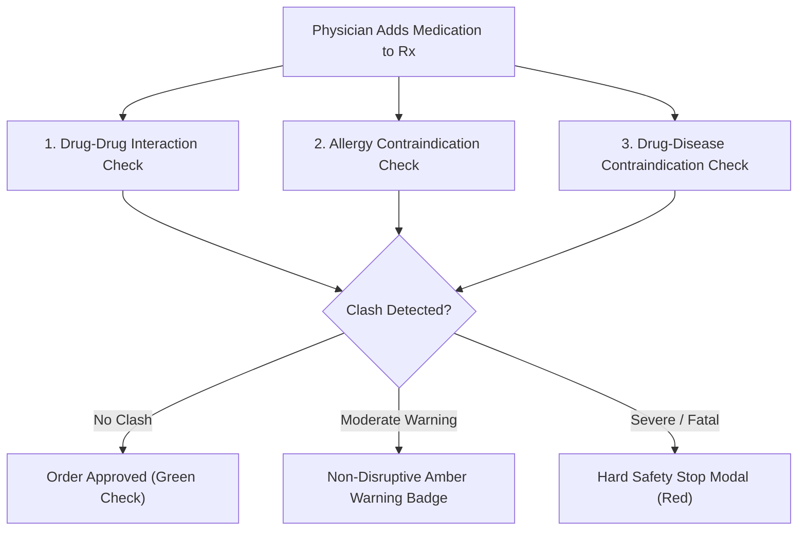

# Avinya HMS – Doctor Clinical Cockpit & Consultation UX
## Document `12_CLINICAL_EMR_UX.md`
### Longitudinal EMR, Structured SOAP Notes, CPOE 1-Click Order Sets & CDS Safety Radar

**Document Version:** `3.0.0-ENTERPRISE-SPEC`  
**Classification:** Enterprise Multi-Tenant Hospital Operating System  
**Parent Document:** [`00_FRONTEND_MASTER_SPEC.md`](00_FRONTEND_MASTER_SPEC.md)  

---

## 1. Executive Summary & Doctor Workspace Mission

The Doctor Clinical Cockpit (`/clinical/encounters/:id`) is the highest-liability and most cognitively demanding workstation in the hospital. Physicians in busy outpatient and inpatient environments make hundreds of life-critical diagnostic, pharmaceutical, and procedural decisions daily under severe time pressure.

Traditional electronic medical records force doctors into endless clicking, dropdown hunting, and clunky modal dialogs, leading to burnout and dangerous cognitive fatigue.

Avinya HMS delivers a **keyboard-first, unified clinical consultation cockpit** that integrates longitudinal patient history, structured documentation, evidence-based order sets, and automated clinical decision support into a single high-velocity screen.

---

## 2. Doctor Consultation Cockpit Layout

```
+────────────────────────────────────────────────────────────────────────────────────────────────────────┐
│ PATIENT HEADER: Doe, John (42y/M) | MRN: AV-2026-00412 | O+ | [!] ALLERGIES: PENICILLIN (ANAPHYLAXIS) │
│ Encounter: OPD Visit #8412 | Attending: Dr. Ramesh Gupta (Cardiology) | Payer: Star Health Cashless    │
├────────────────────────────────────────────────────────────────────────────────────────────────────────┤
│ [TIMELINE] [PREVIOUS VISITS] [ACTIVE MEDICATIONS] [DIAGNOSTIC RESULTS] [PROBLEM LIST]                 │
├───────────────────────────────────────────────────┬────────────────────────────────────────────────────┤
│ 1. CLINICAL NOTE DOCUMENTATION (SOAP)             │ 2. CPOE ORDERS & CLINICAL DECISION SUPPORT         │
│                                                   │                                                    │
│ [Subjective]                                      │ ┌ EVIDENCE-BASED CPOE ORDER SETS ────────────────┐ │
│ Chief Complaint: Chest tightness x 3 days         │ │ [ACS Protocol] [Sepsis Bundle] [Stroke Workup] │ │
│ HPI: Worsens on climbing stairs; relieved by rest.│ └────────────────────────────────────────────────┘ │
│                                                   │                                                    │
│ [Objective]                                       │ ┌ CPOE DIAGNOSTIC & LAB ORDERS ──────────────────┐ │
│ Vitals (Recorded 09:18):                          │ │ • 12-Lead ECG (STAT)                           │ │
│ BP: 148/92 mmHg | HR: 88 bpm | SpO2: 97% | Temp: 98.4│ • Serum Troponin-I High Sensitivity            │ │
│ Physical Exam: S1 S2 heard, no murmurs. Bilateral │ │ • Complete Blood Count (CBC) with Platelets    │ │
│ breath sounds clear.                              │ └────────────────────────────────────────────────┘ │
│                                                   │                                                    │
│ [Assessment - ICD-10 Diagnoses]                   │ ┌ E-PRESCRIPTION (Rx) ───────────────────────────┐ │
│ [ Search ICD-10: I20.9                         ]  │ │ 1. Aspirin 75mg Tab - 1 tab PO OD x 30 days    │ │
│ Selected:                                         │ │ 2. Atorvastatin 40mg Tab - 1 tab PO QHS x 30 d │ │
│ • I20.9 Angina pectoris, unspecified (Primary)    │ │ 3. Clopidogrel 75mg Tab - 1 tab PO OD x 30 days│ │
│ • I10 Essential Hypertension (Chronic)            │ │ 4. Amoxicillin 500mg (TRIGGERED CLASH)         │ │
│                                                   │ └────────────────────────────────────────────────┘ │
│ [Plan]                                            │                                                    │
│ Bed rest, low salt diet, cardiology follow-up in  │ ┌ CLINICAL DECISION SUPPORT (CDS) RADAR ─────────┐ │
│ 7 days or immediate ED presentation if pain recur.│ │ ✖ CONTRAINDICATION: DRUG-ALLERGY CLASH         │ │
│                                                   │ │ Amoxicillin clashes with PENICILLIN ANAPHYLAXIS│ │
│                                                   │ │ Action: Order blocked by safety gate.          │ │
│                                                   │ └────────────────────────────────────────────────┘ │
├───────────────────────────────────────────────────┴────────────────────────────────────────────────────┤
│ [Save Draft (Cmd+S)]                  [Sign & Prescribe (Cmd+Enter)]             [Print Prescription]  │
└────────────────────────────────────────────────────────────────────────────────────────────────────────┘
```

---

## 3. Clinical Decision Support (CDS) Safety Radar

The CDS Radar executes synchronously whenever a physician adds a drug, diagnostic order, or diagnosis:



### Safety Alert Hierarchy:
1. **Severe / Fatal Contraindications (Hard Stop):**
   - *Example:* Prescribing Penicillin to a patient with documented Penicillin Anaphylaxis; or Sildenafil to a patient on Nitroglycerin (fatal hypotension risk).
   - *System Action:* Electronically **blocks order signing**.
   - *Override Protocol:* Can only be bypassed via the **Signed Clinical Override Modal**: requires attending physician to enter an explicit clinical rationale (minimum 20 characters) and provide cryptographic digital signature. The override is permanently logged to the statutory clinical audit vault.
2. **Moderate Drug-Drug Interactions (Amber Warning):**
   - *Example:* Ciprofloxacin + Calcium Antacid (chelation reduces absorption by 50%).
   - *System Action:* Renders non-disruptive amber advisory badge with clinical recommendation: `"Administer Ciprofloxacin 2 hours before or 4 hours after antacids."`

---

## 4. 1-Click CPOE Evidence-Based Order Sets

To reduce documentation time while standardizing clinical care protocols, physicians can trigger pre-bundled order sets:

| Order Set Name | Target Clinical Condition | Pre-Configured Bundled Orders |
|---|---|---|
| **ACS Acute Chest Pain Protocol** | Suspected Myocardial Infarction | STAT 12-Lead ECG, Serum Troponin-I (0h & 3h), Aspirin 300mg stat, Clopidogrel 300mg stat, Continuous telemetry. |
| **Sepsis Resuscitation Bundle** | Severe Sepsis / Septic Shock | Blood Cultures x 2 sets, Serum Lactate, CBC, IV Crystalloid 30 mL/kg, Broad-spectrum empiric IV antibiotics within 1 hour. |
| **Acute Ischemic Stroke Protocol** | Acute Focal Neurological Deficit | Non-contrast Head CT (STAT), Fingerstick Blood Glucose, PT/INR, PTT, Type & Screen, Neuro ICU bed reservation. |
| **Diabetic Ketoacidosis (DKA)** | Severe Hyperglycemia with Ketosis | Arterial Blood Gas (ABG), Serum Electrolytes & Anion Gap, Urinalysis, Regular Insulin infusion protocol, IV Normal Saline. |

---

## 5. Keyboard-First Navigation Standards

Physicians can execute an entire consultation without touching a mouse:
- `Cmd + S` / `Ctrl + S`: Autosave draft clinical note without closing.
- `Cmd + Enter` / `Ctrl + Enter`: Trigger CDS verification and sign note / e-prescription.
- `Alt + O`: Focus CPOE diagnostic order search bar.
- `Alt + R`: Focus medication prescription search bar.
- `Alt + D`: Focus ICD-10 diagnosis search bar.
- `Esc`: Close any active modal or return focus to SOAP editor.

